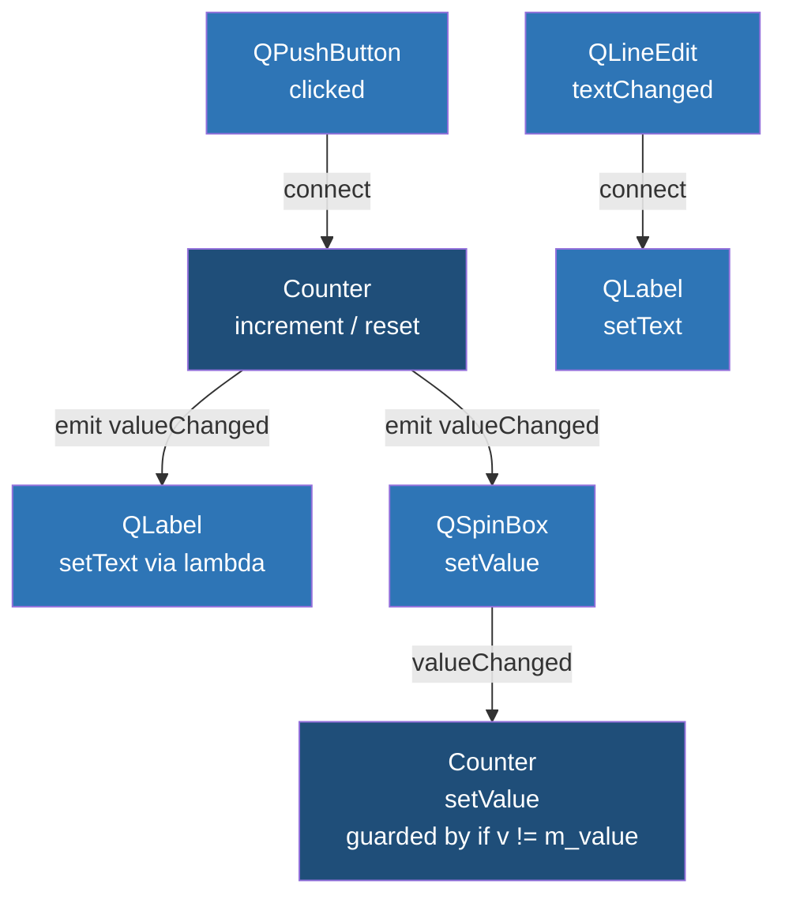
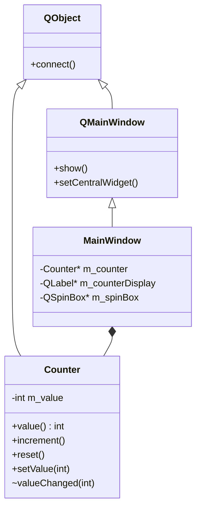

# Qt Signals & Slots Demo

A Qt6 C++ project demonstrating the three most important Qt concepts:
**signals & slots**, **QObject subclassing**, and the **event loop**.

---

## 1. Prerequisites

Install the required packages:

```bash
sudo apt update
sudo apt install qt6-base-dev cmake build-essential qtcreator
```

| Package | Purpose |
|---|---|
| `qt6-base-dev` | Qt6 core libraries + headers |
| `cmake` | Build system (3.16+ required) |
| `build-essential` | GCC/G++ compiler toolchain |
| `qtcreator` | IDE with Designer, debugger, CMake integration |

---

## 2. Qt Creator — Kit Configuration

After installing, Qt Creator needs to be linked to your system Qt6 before it can build anything.

**Step 1 — Open Preferences**

Go to `Edit → Preferences → Kits`

**Step 2 — Add Qt Version**

- Click the **Qt Versions** tab → **Add...**
- Find `qmake6` with:
```bash
which qmake6
# typically: /usr/lib/qt6/bin/qmake6
```
- Select it and click Open

**Step 3 — Configure the Kit**

- Go back to the **Kits** tab → select **Desktop (default)**
- Set **Qt version** to the Qt6 you just added
- Compiler should show: `GCC 13 (C++, x86 64bit)`
- CMake Tool should show: `System CMake at /usr/bin/cmake`
- Click **Apply → OK**

> If the kit shows a warning triangle, the Qt version was not linked correctly — repeat Step 2.

---

## 3. Create a New Qt Widgets Project

1. `File → New Project...`
2. Select **Application (Qt) → Qt Widgets Application**
3. Set project name (e.g. `qt_signals_demo`) and location
4. Build system: **CMake**
5. Leave class name as `MainWindow` → Next
6. Select your **Qt6 Desktop kit** → Finish

Qt Creator generates: `main.cpp`, `mainwindow.h`, `mainwindow.cpp`, `mainwindow.ui`, `CMakeLists.txt`

> Press `Ctrl+R` first to verify the default empty window builds before replacing any files.

---

## 4. Project File Structure

Replace the generated files with the following:

```
qt_signals_demo/
├── CMakeLists.txt      # Build config — Qt6, AUTOMOC, all sources
├── main.cpp            # Entry point — QApplication + MainWindow
├── mainwindow.h        # MainWindow class declaration
├── mainwindow.cpp      # UI layout + signal/slot wiring
├── counter.h           # Counter QObject — custom signal declaration
└── counter.cpp         # Counter slots: increment, reset, setValue
```

> `mainwindow.ui` from the generated project can stay in the folder — it is no longer referenced by `CMakeLists.txt`.

---

## 5. CMakeLists.txt — Changes from Default

The only required change to the generated `CMakeLists.txt` is adding `counter.h` and `counter.cpp` to `PROJECT_SOURCES`:

```cmake
set(PROJECT_SOURCES
    main.cpp
    mainwindow.cpp
    mainwindow.h
    counter.cpp      # added
    counter.h        # added
)
```

The three AUTO* flags must remain enabled:

```cmake
set(CMAKE_AUTOUIC ON)   # Processes .ui files
set(CMAKE_AUTOMOC ON)   # Runs moc on Q_OBJECT classes  ← critical
set(CMAKE_AUTORCC ON)   # Processes .qrc resource files
```

> `CMAKE_AUTOMOC` is the critical one. It scans all source files for `Q_OBJECT` and generates
> the `moc_*.cpp` files that make signals/slots work. Without it you get linker errors about missing vtables.

---

## 6. Signals & Slots — How It Works

Qt's signal/slot system is a type-safe observer pattern built into the language via the
Meta-Object Compiler (moc).

**Rules:**
- Class must inherit from `QObject` (directly or via any Qt widget)
- Must declare `Q_OBJECT` in the private section
- Signals are declared in `signals:` — never implemented by you
- Slots are regular methods declared in `public slots:`
- `emit` triggers a signal and calls all connected slots synchronously

**Connect syntax:**
```cpp
connect(sender,   &SenderClass::signalName,
        receiver, &ReceiverClass::slotName);

// Lambda as slot:
connect(sender, &SenderClass::signal, this, [this](int v) {
    label->setText(QString::number(v));
});
```

### Signal flow in this project



---

## 7. The Three Demos

### Demo 1 — Button click drives Counter

```cpp
connect(btnIncrement, &QPushButton::clicked, m_counter, &Counter::increment);
connect(btnReset,     &QPushButton::clicked, m_counter, &Counter::reset);
connect(m_counter, &Counter::valueChanged, this, [this](int v) {
    m_counterDisplay->setText(QString("Count: %1").arg(v));
});
```

Button signal → custom slot → custom signal → lambda updates the label. Classic chain.

---

### Demo 2 — SpinBox bidirectionally synced to Counter

```cpp
connect(m_spinBox, QOverload<int>::of(&QSpinBox::valueChanged),
        m_counter, &Counter::setValue);
connect(m_counter, &Counter::valueChanged,
        m_spinBox, &QSpinBox::setValue);
```

`QOverload<int>::of(...)` disambiguates overloaded signals — a very common Qt pattern.
The `setValue` slot guards against infinite feedback loops with `if (v != m_value)`.

---

### Demo 3 — LineEdit mirrors to Label (pure built-in)

```cpp
connect(input, &QLineEdit::textChanged, mirror, &QLabel::setText);
```

No custom class needed. Many Qt built-in widgets connect directly to each other.

---

## 8. Class Architecture



---

## 9. Build & Run

**In Qt Creator:**

After replacing/adding files:
1. Right-click the project → **Run CMake**
2. `Ctrl+B` to build
3. `Ctrl+R` to run

**From terminal:**

```bash
cd ~/Desktop/Programming/QTprojects/qt_signals_demo
mkdir build && cd build
cmake ..
cmake --build .
./qt_signals_demo
```

---

## 10. Qt Classes Reference

| Class | Purpose |
|---|---|
| `QApplication` | Manages event loop, argc/argv, Qt resources |
| `QMainWindow` | Top-level window with menu/toolbar/statusbar support |
| `QWidget` | Base class for all UI elements |
| `QObject` | Base class for signal/slot capable objects (non-visual) |
| `QVBoxLayout` / `QHBoxLayout` | Arrange child widgets vertically / horizontally |
| `QPushButton` | Clickable button — emits `clicked()` |
| `QLabel` | Displays text or image — has `setText()` slot |
| `QLineEdit` | Single-line text input — emits `textChanged(QString)` |
| `QSpinBox` | Integer input with arrows — emits `valueChanged(int)` |
| `QString` | Qt's Unicode string class — use `.arg()` for formatting |
