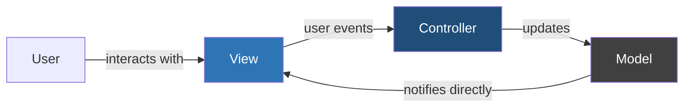
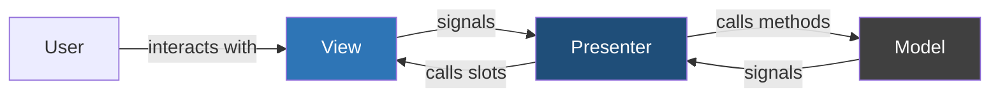
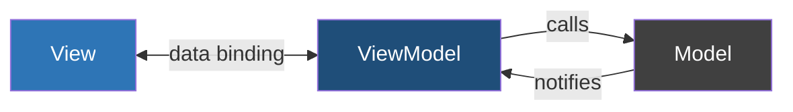
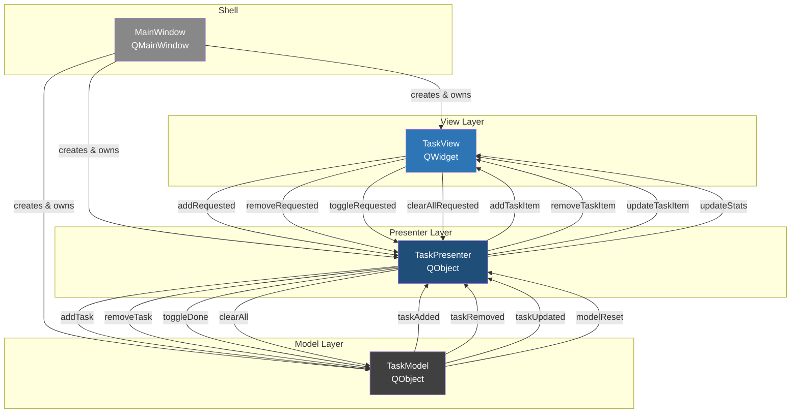
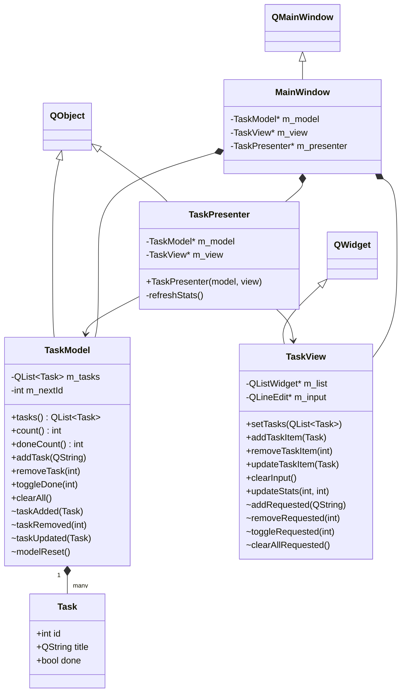
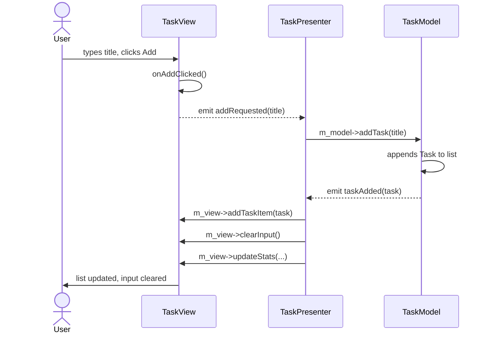

# Qt MVP Demo — Task Manager

A Qt6 C++ project demonstrating the **MVP (Model-View-Presenter)** pattern,
and how it relates to **MVC (Model-View-Controller)**. Built as a Task Manager
application where all three layers are cleanly separated.

---

## 1. MVC vs MVP — What Is the Difference?

Both patterns solve the same problem: **separating UI from business logic**.
They differ in who controls the flow.

### MVC — Model View Controller

The original pattern, invented for Smalltalk in the 1970s.



- The **View** can observe the **Model** directly
- The **Controller** handles input and updates the Model
- The **Model** notifies the View directly when it changes
- View and Model are **aware of each other**

**Problem:** In practice the View ends up tightly coupled to the Model.
Hard to test the View without the Model being present.

---

### MVP — Model View Presenter

A refinement of MVC popular in Qt, Android (classic), and WinForms.



- The **Presenter** sits in the middle — View and Model never talk directly
- The **View** only emits signals and exposes update slots
- The **Model** only owns data and emits signals when it changes
- View and Model are **completely unaware of each other**

**Benefit:** You can test the Presenter + Model without any widgets.
You can swap the View entirely without touching the Model.

---

### Side-by-side comparison

| Aspect | MVC | MVP |
|---|---|---|
| Who handles input? | Controller | Presenter |
| View ↔ Model relationship | Direct (observer) | None — Presenter only |
| Testability | Medium | High — Presenter testable without UI |
| Coupling | View knows Model | View knows nothing |
| Qt fit | Loose fit | Natural fit with signals/slots |
| Used in | Web frameworks, games | Qt Widgets, Android classic |

---

### MVVM — for completeness



MVVM adds **automatic two-way data binding** between View and ViewModel.
In Qt this is the standard pattern when using **QML** — the QML engine
handles the binding automatically via `Q_PROPERTY`. With pure Qt Widgets
(no QML), MVVM is harder to implement cleanly, so MVP is preferred.

---

## 2. This Project — MVP Architecture



**The golden rule:** The arrows between layers only point **through the Presenter**.
`TaskView` and `TaskModel` have zero knowledge of each other.

---

## 3. Layer Responsibilities

### Model — `taskmodel.h / taskmodel.cpp`

```
Owns:    QList<Task>  (the data)
Exposes: addTask(), removeTask(), toggleDone(), clearAll()
Emits:   taskAdded, taskRemoved, taskUpdated, modelReset
Knows:   Nothing about any widget or presenter
```

The Model is a pure data manager. It could be used in a command-line
app, a unit test, or a completely different UI without any changes.

---

### View — `taskview.h / taskview.cpp`

```
Owns:    All widgets (QListWidget, QLineEdit, QPushButton, QLabel)
Exposes: setTasks(), addTaskItem(), removeTaskItem(), updateTaskItem(),
         clearInput(), updateStats()
Emits:   addRequested, removeRequested, toggleRequested, clearAllRequested
Knows:   Nothing about TaskModel or TaskPresenter
```

The View translates raw widget events (button clicks, double-clicks)
into meaningful **intention signals**. It does not decide what happens next —
it just announces what the user wanted.

---

### Presenter — `taskpresenter.h / taskpresenter.cpp`

```
Owns:    Pointers to Model and View (does not own lifetime)
Wires:   View signals → Model methods
         Model signals → View update methods
Knows:   Both Model and View interfaces
Contains: Application logic — "when X happens, do Y then update Z"
```

The Presenter is the brain. All decisions live here:
- When `addRequested` fires → call `m_model->addTask()` then `m_view->clearInput()`
- When `taskAdded` fires → call `m_view->addTaskItem()` then `refreshStats()`

---

### MainWindow — `mainwindow.h / mainwindow.cpp`

```
Role:    Application shell only
Does:    Creates Model, View, Presenter — nothing else
Logic:   Zero
```

```cpp
m_model     = new TaskModel(this);
m_view      = new TaskView(this);
m_presenter = new TaskPresenter(m_model, m_view, this);
setCentralWidget(m_view);
```

This is the entire body of `MainWindow`. Clean.

---

## 4. Class Diagram



---

## 5. Signal Flow — What Happens When User Adds a Task



---

## 6. CMakeLists.txt — Key Points

```cmake
set(PROJECT_SOURCES
    main.cpp
    mainwindow.cpp   mainwindow.h
    taskmodel.cpp    taskmodel.h
    taskview.cpp     taskview.h
    taskpresenter.cpp taskpresenter.h
)
```

All three layers must be listed. `CMAKE_AUTOMOC ON` handles moc
generation for every file containing `Q_OBJECT`.

---

## 7. Build & Run

**In Qt Creator:**
1. Right-click project → **Run CMake**
2. `Ctrl+B` — build
3. `Ctrl+R` — run

**From terminal:**
```bash
mkdir build && cd build
cmake ..
cmake --build .
./qt_mvc_demo
```

---

## 8. Why MVP Over Plain Qt?

| Situation | Without MVP | With MVP |
|---|---|---|
| Add feature | Edit mainwindow.cpp (grows forever) | Add method to correct layer only |
| Unit test logic | Must instantiate widgets | Test Presenter + Model, no widgets |
| Swap UI toolkit | Rewrite everything | Rewrite View only |
| Find a bug | Search all files | Bug is in exactly one layer |
| New developer | Reads 1000-line mainwindow.cpp | Reads 3 focused files |

For a project where the backend logic is complex (for example a networked application),
MVP ensures the communication logic never gets mixed with widget code.
