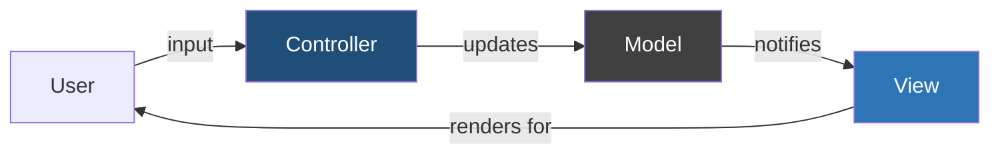
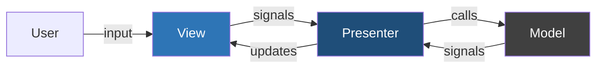
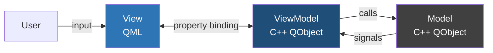
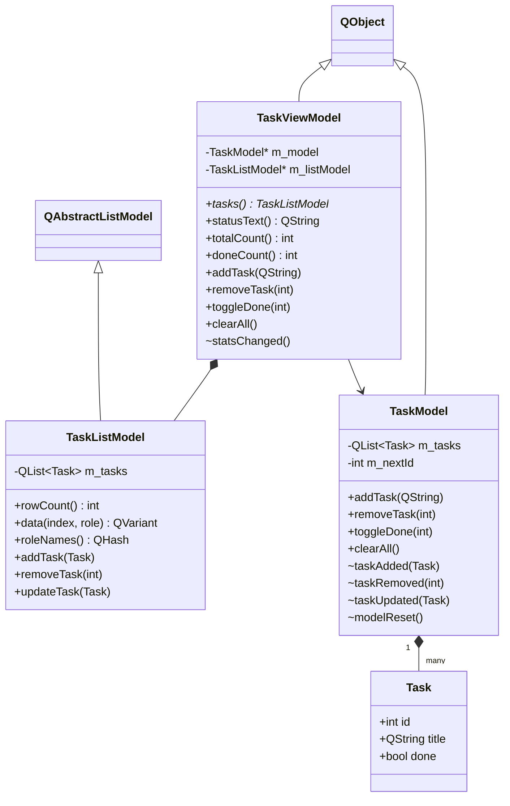
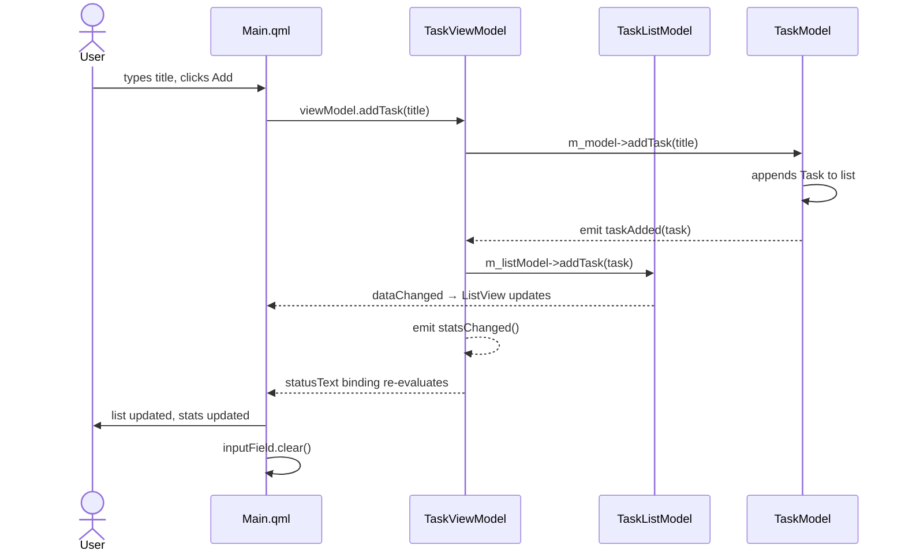
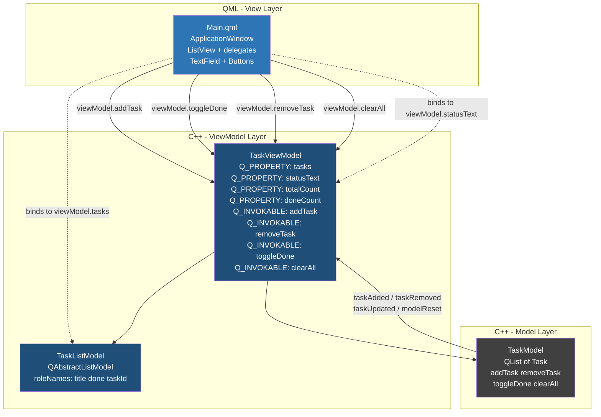

# Qt MVVM Demo — Task Manager (QML)

A Qt6 C++ + QML project demonstrating the **MVVM (Model-View-ViewModel)**
pattern. This is the natural architecture for Qt Quick / QML applications,
where the QML binding engine replaces manual `connect()` calls with
**automatic property binding**.

---

## 1. Prerequisites — System Packages

Install all required packages before creating the project:

```bash
sudo apt update
sudo apt install \
  qt6-base-dev \
  qt6-declarative-dev \
  qml6-module-qtquick \
  qml6-module-qtquick-controls \
  qml6-module-qtquick-layouts \
  qml6-module-qtquick-window \
  qml6-module-qtquick-templates \
  cmake \
  build-essential \
  qtcreator
```

| Package | Purpose |
|---|---|
| `qt6-base-dev` | Qt6 core libraries |
| `qt6-declarative-dev` | QML engine + Qt Quick framework |
| `qml6-module-qtquick` | `import QtQuick` in QML |
| `qml6-module-qtquick-controls` | `Button`, `TextField`, `CheckBox`, `ApplicationWindow` |
| `qml6-module-qtquick-layouts` | `ColumnLayout`, `RowLayout` |
| `qml6-module-qtquick-window` | `QtQuick.Window` — required by Controls |
| `qml6-module-qtquick-templates` | `QtQuick.Templates` — required by Controls |
| `cmake` | Build system (3.16+ required) |
| `build-essential` | GCC/G++ compiler toolchain |
| `qtcreator` | IDE with Designer, debugger, CMake integration |

> **Important:** `qml6-module-qtquick-window` and `qml6-module-qtquick-templates`
> are not pulled in automatically by apt even though Controls depends on them.
> The app will build fine but crash at runtime with
> `Type ApplicationWindow unavailable` if they are missing.

---

## 2. Create the Project in Qt Creator

1. `File → New Project...`
2. Select **Application (Qt) → Qt Quick Application**
3. Set name: `qt_mvvm_demo`, choose location → Next
4. Build system: **CMake** → Next
5. Details screen: leave both checkboxes **unchecked**, Qt version: **Qt 6.4** → Next
6. Select your **Qt6 Desktop kit** → Finish

Qt Creator generates: `main.cpp`, `Main.qml`, `CMakeLists.txt`

> Press `Ctrl+R` to verify the default window builds before replacing files.

---

## 3. Known Build Issue — Executable Name Clash

`qt_add_qml_module` always creates a **directory** named after the URI
(`qt_mvvm_demo`) inside the build folder for its `qmldir` file.
If the executable is also named `qt_mvvm_demo`, the linker fails with:

```
cannot open output file qt_mvvm_demo: Is a directory
```

**The fix:** name the executable `app` in `CMakeLists.txt`:

```cmake
qt_add_executable(app ...)          # executable = app
qt_add_qml_module(app URI qt_mvvm_demo ...)  # qml dir = qt_mvvm_demo/
```

The URI stays `qt_mvvm_demo` so the QRC path `qrc:/qt_mvvm_demo/Main.qml`
in `main.cpp` remains correct.

---

## 4. MVVM — Full Pattern Explanation

### The Problem All Three Patterns Solve

As applications grow, putting everything in one class creates an
unmaintainable mess — UI code, data logic, and business rules get tangled.
MVC, MVP, and MVVM all solve this by splitting responsibilities into layers.

---

### MVC — Origin (1970s, Smalltalk)



- **Controller** handles user input
- **Model** holds data, notifies View directly
- **View** observes Model and re-renders
- Problem: View and Model are coupled — hard to test View without Model

---

### MVP — Qt Widgets (previous project)



- **Presenter** sits between View and Model — they never touch
- All logic lives in Presenter
- Manual `connect()` calls everywhere
- Great for Qt Widgets

---

### MVVM — Qt QML (this project)



- **ViewModel** exposes data as `Q_PROPERTY` — QML binds automatically
- **View (QML)** has zero logic — only binding expressions and invokable calls
- **Model** is identical to MVP — pure data, fully reusable
- The QML binding engine replaces manual `connect()` on the UI side

---

### Pattern Comparison

| Aspect | MVC | MVP | MVVM |
|---|---|---|---|
| UI technology | Web, desktop | Qt Widgets, Android | Qt QML, WPF, SwiftUI |
| UI ↔ Logic link | Direct observer | Manual connect() | Automatic property binding |
| View knows Model? | Yes | No | No |
| Testability | Medium | High | Very high |
| Boilerplate | Medium | High (many slots) | Low (binding is automatic) |
| Best Qt fit | No | Qt Widgets | Qt Quick / QML |

---

## 5. Project Architecture


**Solid arrows** = method calls.
**Dashed arrows** = automatic QML property bindings — no code needed.

---

## 6. Project File Structure

```
qt_mvvm_demo/
├── CMakeLists.txt          # qt_add_qml_module bundles QML into executable
├── main.cpp                # Creates Model + ViewModel, exposes to QML engine
├── taskmodel.h/.cpp        # MODEL — identical to MVP version, fully reusable
├── taskviewmodel.h/.cpp    # VIEWMODEL — Q_PROPERTY + Q_INVOKABLE + QAbstractListModel
└── Main.qml                # VIEW — declarative UI, zero logic
```

---

## 7. The Key New Concepts

### Q_PROPERTY

The bridge between C++ and QML. Declared in the ViewModel:

```cpp
Q_PROPERTY(QString statusText READ statusText NOTIFY statsChanged)
```

| Part | Meaning |
|---|---|
| `READ statusText` | QML reads value via this C++ getter |
| `NOTIFY statsChanged` | When this signal fires, QML re-reads automatically |

In QML, binding is just:
```qml
Label { text: viewModel.statusText }
```

No `connect()`. No slot. When `statsChanged()` fires in C++,
every QML element bound to `statusText` updates automatically.

---

### Q_INVOKABLE

Methods callable directly from QML:

```cpp
Q_INVOKABLE void addTask(const QString& title);
```

In QML:
```qml
Button {
    onClicked: viewModel.addTask(inputField.text)
}
```

---

### QAbstractListModel

The protocol Qt uses to feed lists to QML `ListView`.
You implement three methods:

```cpp
int      rowCount(...)              // how many items
QVariant data(index, role)          // value for a given item + role
QHash<int, QByteArray> roleNames()  // maps role IDs to QML property names
```

After this, QML accesses your data by role name directly in the delegate:
```qml
delegate: Label { text: title }   // 'title' comes from roleNames()
```

---

### qt_add_qml_module (CMake)

Bundles `.qml` files directly into the executable as resources:

```cmake
qt_add_qml_module(app
    URI qt_mvvm_demo
    VERSION 1.0
    QML_FILES Main.qml
)
```

No separate `.qml` files needed at runtime — everything is compiled in.
The URI becomes the QRC path: `qrc:/qt_mvvm_demo/Main.qml`

---

## 8. Class Diagram



---

## 9. Signal Flow — Adding a Task



---

## 10. Build & Run

**In Qt Creator:**
1. Copy all files into your `qt_mvvm_demo` project folder
2. Right-click project → **Run CMake**
3. `Ctrl+B` — build
4. `Ctrl+R` — run

**From terminal:**
```bash
mkdir build && cd build
cmake ..
cmake --build .
./app
```

---

## 11. MVP vs MVVM — When to Use Which in Qt

| Use MVP (Qt Widgets) | Use MVVM (Qt QML) |
|---|---|
| Desktop tools, simulation UIs | Consumer apps, embedded HMIs |
| Complex custom widgets | Fluid animations and transitions |
| Existing Widgets codebase | New project from scratch |
| Fine-grained layout control | Rapid UI iteration |
| Simulation control stations | Car dashboards, mobile apps |

For MCX/MCPTT backend work — **Qt Widgets + MVP** for control UIs.
For embedded HMIs and modern touch UIs — **Qt QML + MVVM**.
  qml6-module-qtquick-controls \
  qml6-module-qtquick-layouts \
  qml6-module-qtquick-window \
  cmake \
  build-essential \
  qtcreator
```

| Package | Purpose |
|---|---|
| `qt6-base-dev` | Qt6 core libraries |
| `qt6-declarative-dev` | QML engine + Qt Quick framework |
| `qml6-module-qtquick` | `import QtQuick` in QML |
| `qml6-module-qtquick-controls` | `Button`, `TextField`, `CheckBox`, `ApplicationWindow` |
| `qml6-module-qtquick-layouts` | `ColumnLayout`, `RowLayout` |
| `qml6-module-qtquick-window` | `ApplicationWindow` root element |
| `cmake` | Build system |
| `build-essential` | GCC/G++ compiler |
| `qtcreator` | IDE |

> **Note:** If you skip any QML module package, the app will build but crash
> at runtime with `module "QtQuick.Controls" is not installed`.

---

## 2. Create the Project in Qt Creator

1. `File → New Project...`
2. Select **Application (Qt) → Qt Quick Application**
3. Set name: `qt_mvvm_demo`, choose location → Next
4. Build system: **CMake** → Next
5. Details screen: leave both checkboxes **unchecked**, Qt version: **Qt 6.4** → Next
6. Select your **Qt6 Desktop kit** → Finish

Qt Creator generates: `main.cpp`, `Main.qml`, `CMakeLists.txt`

---

## 3. MVVM — Full Pattern Explanation

### The Problem All Three Patterns Solve

As applications grow, putting everything in one class creates an
unmaintainable mess. UI code, data logic, and business rules get tangled.
MVC, MVP, and MVVM all solve this by splitting responsibilities into layers.

---

### MVC — Origin (1970s, Smalltalk)


- **Controller** handles user input
- **Model** holds data, notifies View directly
- **View** observes Model and re-renders
- Problem: View and Model are coupled — hard to test View without Model

---

### MVP — Qt Widgets (what the previous project uses)


- **Presenter** sits between View and Model — they never touch
- All logic lives in Presenter
- Manual `connect()` calls everywhere
- Great for Qt Widgets

---

### MVVM — Qt QML (this project)


- **ViewModel** exposes data as **Q_PROPERTY** — QML binds automatically
- **View (QML)** has zero logic — only binding expressions and invokable calls
- **Model** is identical to MVP — pure data
- The QML binding engine replaces manual `connect()` on the UI side

---

### Pattern Comparison

| Aspect | MVC | MVP | MVVM |
|---|---|---|---|
| UI technology | Web, desktop | Qt Widgets, Android | Qt QML, WPF, SwiftUI |
| UI ↔ Logic link | Direct observer | Manual connect() | Automatic property binding |
| View knows Model? | Yes | No | No |
| Testability | Medium | High | Very high |
| Boilerplate | Medium | High (lots of slots) | Low (binding is automatic) |
| Best Qt fit | No | Qt Widgets | Qt Quick / QML |

---

## 4. Project Architecture



**Solid arrows** = method calls.
**Dashed arrows** = automatic QML property bindings (no code needed).

---

## 5. Project File Structure

```
qt_mvvm_demo/
├── CMakeLists.txt          # qt_add_qml_module bundles QML into executable
├── main.cpp                # Creates Model + ViewModel, exposes to QML engine
├── taskmodel.h/.cpp        # MODEL — identical to MVP version, fully reusable
├── taskviewmodel.h/.cpp    # VIEWMODEL — Q_PROPERTY + Q_INVOKABLE + QAbstractListModel
└── qml/
    └── Main.qml            # VIEW — declarative UI, zero logic
```

---

## 6. The Key New Concepts

### Q_PROPERTY

The bridge between C++ and QML. Declared in the ViewModel:

```cpp
Q_PROPERTY(QString statusText READ statusText NOTIFY statsChanged)
```

- `READ statusText` — QML reads value via this getter
- `NOTIFY statsChanged` — when this signal fires, QML re-reads automatically

In QML, binding is just:
```qml
Label { text: viewModel.statusText }
```

No `connect()`. No slot. When `statsChanged()` fires in C++,
QML updates the label automatically.

---

### Q_INVOKABLE

Methods callable directly from QML:

```cpp
Q_INVOKABLE void addTask(const QString& title);
```

In QML:
```qml
Button {
    onClicked: viewModel.addTask(inputField.text)
}
```

---

### QAbstractListModel

The protocol Qt uses to feed lists to QML `ListView`.
You implement three methods:

```cpp
int      rowCount(...)          // how many items
QVariant data(index, role)      // value for a given item + role
QHash<int, QByteArray> roleNames()  // maps role IDs to QML property names
```

After this, QML accesses your data by role name:
```qml
delegate: Label { text: title }   // 'title' comes from roleNames()
```

---

### qt_add_qml_module (CMake)

Bundles `.qml` files directly into the executable as resources:

```cmake
qt_add_qml_module(qt_mvvm_demo
    URI qt_mvvm_demo
    VERSION 1.0
    QML_FILES
        qml/Main.qml
)
```

No separate `.qml` files needed at runtime — everything is compiled in.

---

## 7. Class Diagram


---

## 8. Signal Flow — Adding a Task


---

## 9. Build & Run

**In Qt Creator:**
1. Copy all files into your `qt_mvvm_demo` project folder
2. Right-click project → **Run CMake**
3. `Ctrl+B` — build
4. `Ctrl+R` — run

**From terminal:**
```bash
mkdir build && cd build
cmake ..
cmake --build .
./qt_mvvm_demo
```

---

## 10. MVP vs MVVM — When to Use Which in Qt

| Use MVP (Qt Widgets) | Use MVVM (Qt QML) |
|---|---|
| Desktop tools, simulation UIs | Consumer apps, embedded HMIs |
| Complex custom widgets | Fluid animations and transitions |
| Existing Widgets codebase | New project from scratch |
| Fine-grained layout control | Rapid UI iteration |
| Airbus-style sim control stations | Car dashboards, mobile apps |

In practice for your work context — **MCX/MCPTT backends** pair with
Qt Widgets (MVP) for control UIs, while **embedded HMIs** (automotive,
industrial displays) use QML (MVVM).
