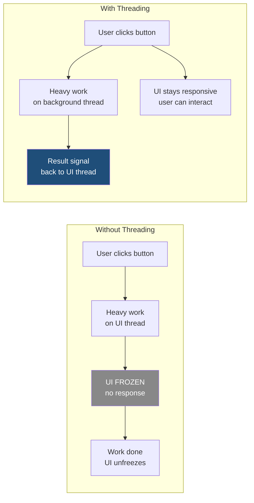
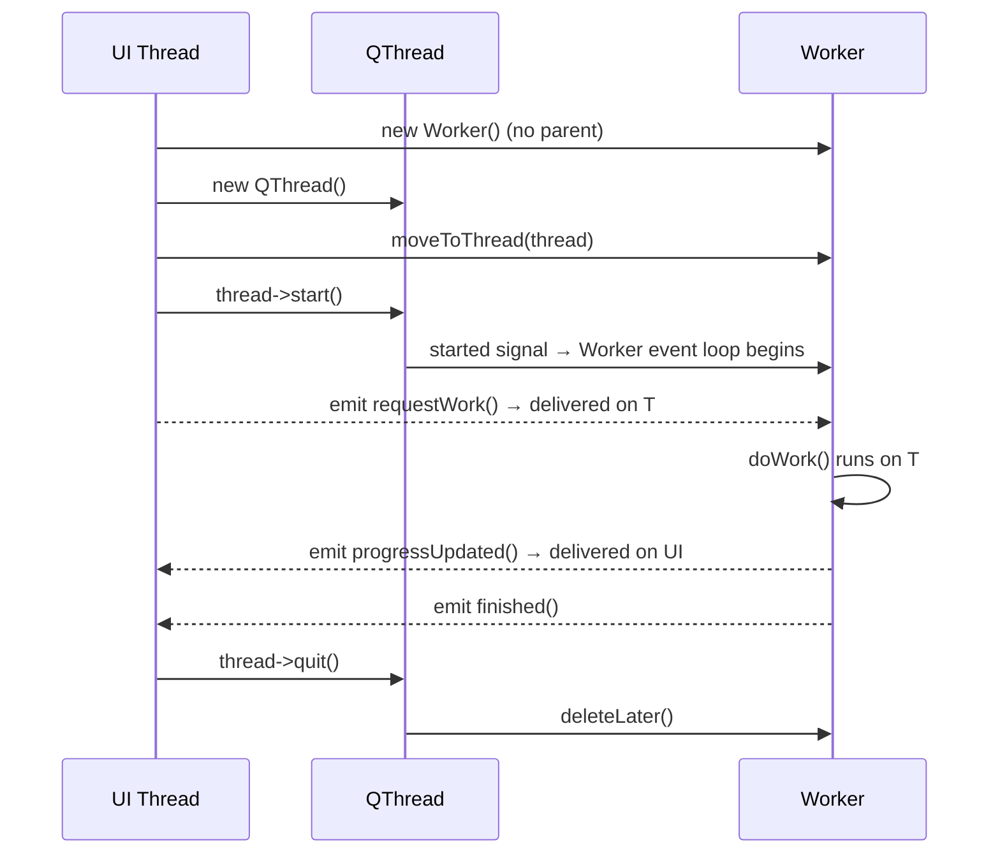
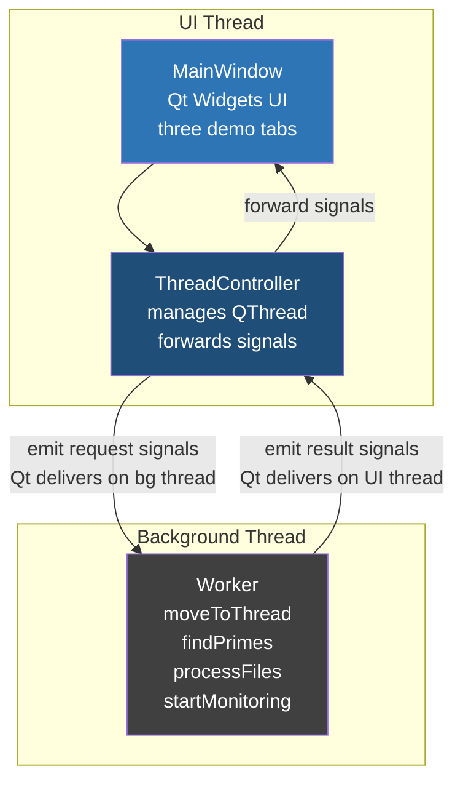
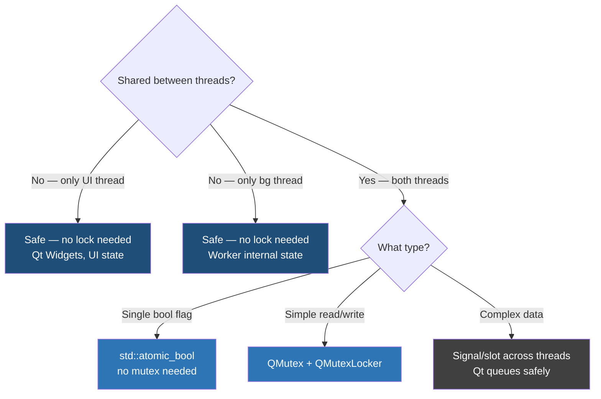

# Qt Threading Demo — QThread + Worker Pattern

A Qt6 C++ project demonstrating **multithreading** using `QThread`
and the **Worker Object Pattern**. Three demos: heavy computation,
file processing with progress, and continuous live monitoring.

---

## 1. Prerequisites

```bash
sudo apt install qt6-base-dev qt6-charts-dev cmake build-essential qtcreator
```

| Package | Purpose |
|---|---|
| `qt6-base-dev` | Qt6 core + Widgets + QThread |
| `qt6-charts-dev` | QChart, QLineSeries — live CPU chart |

---

## 2. Why Threading?

Without threading, any heavy work on the UI thread freezes the window:



---

## 3. Two Ways to Use QThread

### Way 1 — Subclass QThread (simple, limited)

```cpp
class MyThread : public QThread {
    void run() override {
        // work here
        // PROBLEM: can't easily use signals/slots from run()
    }
};
MyThread* t = new MyThread();
t->start();
```

Works for simple cases but signals/slots from within `run()` don't
connect cleanly to the UI thread.

### Way 2 — Worker Object Pattern (recommended ✅)

```cpp
Worker* worker = new Worker();      // QObject, no parent
QThread* thread = new QThread();
worker->moveToThread(thread);       // worker now lives on thread
connect(thread, &QThread::started, worker, &Worker::doWork);
connect(worker, &Worker::finished, thread, &QThread::quit);
connect(thread, &QThread::finished, worker, &QObject::deleteLater);
thread->start();
```

All worker slots now run on the background thread. Qt delivers
signals across threads safely and automatically.

---

## 4. Worker Object Pattern — Step by Step



---

## 5. Project Structure

```
qt_thread_demo/
├── CMakeLists.txt
├── main.cpp
├── mainwindow.h/.cpp      # UI — three demo tabs + live chart
├── worker.h/.cpp          # runs on background thread
└── threadcontroller.h/.cpp # manages QThread lifecycle
```

---

## 6. Architecture



---

## 7. Thread-Safe Signal Delivery

Qt's signal/slot system is thread-aware. When sender and receiver
are on different threads, Qt automatically uses a **queued connection**:


```cpp
// This works safely across threads — Qt handles it automatically
connect(worker, &Worker::progressUpdated,    // emitted on bg thread
        this,   &MainWindow::onProgress);    // runs on UI thread
// No mutex, no lock needed for this pattern
```

---

## 8. The Three Demos

### Demo 1 — Prime Search (heavy computation)

```cpp
void Worker::findPrimes(int upTo) {
    for (int i = 2; i <= upTo; i++) {
        if (isPrime(i)) count++;
        if (i % 10000 == 0)
            emit progressUpdated(i, upTo, "Checking...");
    }
    emit primesFound(count, timer.elapsed());
}
```

Without threading this loop would freeze the UI for several seconds.
On a background thread the progress bar updates smoothly.

---

### Demo 2 — File Processing (progress reporting)

```cpp
void Worker::processFiles(int fileCount) {
    for (int i = 0; i < fileCount; i++) {
        QThread::msleep(delay);         // simulate work
        emit fileProcessed(i+1, name, size);
        emit progressUpdated(i+1, fileCount, "Processing...");
    }
    emit allFilesProcessed(fileCount, timer.elapsed());
}
```

Each file emits a signal. Qt queues the signal delivery to the UI
thread — the file log updates line by line as work progresses.

---

### Demo 3 — Continuous Monitoring (atomic stop flag)

```cpp
// Worker — background thread
void Worker::startMonitoring(int intervalMs) {
    m_stopMonitoring = false;           // std::atomic<bool>
    while (!m_stopMonitoring) {
        emit monitoringData(cpu, mem, timestamp);
        QThread::msleep(intervalMs);
    }
}

void Worker::stopMonitoring() {
    m_stopMonitoring = true;            // atomic write — thread safe
}
```

`std::atomic<bool>` is the correct tool for a simple stop flag
shared between threads. No mutex needed for a single boolean.

---

## 9. Thread Safety — What Needs Protection



**Rule of thumb:** Use signals/slots for data exchange between threads.
Use `std::atomic` or `QMutex` only when you truly need shared memory.

---

## 10. Shutdown — Critical Pattern

Always shut down the thread cleanly to avoid crashes:

```cpp
// In ThreadController destructor
void ThreadController::teardownThread() {
    emit requestStop();      // tell worker to exit any loops
    m_thread->quit();        // stop the thread event loop
    m_thread->wait(3000);    // wait max 3 seconds
}

// In setupThread — clean delete chain
connect(m_thread, &QThread::finished,
        m_worker, &QObject::deleteLater);  // safe delete on thread
```

**Never** call `delete worker` directly from the UI thread after
`moveToThread` — use `deleteLater()` which is thread-safe.

---

## 11. CMakeLists — Charts Module

```cmake
find_package(Qt6 REQUIRED COMPONENTS Core Widgets Charts)

target_link_libraries(qt_thread_demo PRIVATE
    Qt6::Core
    Qt6::Widgets
    Qt6::Charts    # QChart, QLineSeries, QChartView
)
```

```bash
sudo apt install qt6-charts-dev
```

---

## 12. Create Project in Qt Creator

1. `File → New Project → Application (Qt) → Qt Widgets Application`
2. Name: `qt_thread_demo`
3. Location: `~/Desktop/Programming/QTprojects/`
4. Build system: **CMake** → Finish
5. Replace all generated files with provided files
6. Right-click → **Run CMake** → `Ctrl+R`

---

## 13. What This Covers

| Concept | Where |
|---|---|
| Worker Object Pattern | `ThreadController::setupThread()` |
| `moveToThread()` | `ThreadController::setupThread()` |
| Cross-thread signal delivery | All Worker signals |
| `std::atomic<bool>` stop flag | `Worker::m_stopMonitoring` |
| `QThread::msleep()` | `Worker::processFiles()` |
| Clean thread shutdown | `ThreadController::teardownThread()` |
| `deleteLater()` — safe cross-thread delete | shutdown chain |
| `QMutex` declaration | `Worker::m_mutex` |
| Live `QChart` + `QLineSeries` | `MainWindow` Demo 3 |
| Keeping UI responsive during heavy work | Demo 1 prime search |
| Progress reporting from background | Demo 2 file processing |
| Continuous monitoring loop | Demo 3 monitor |
