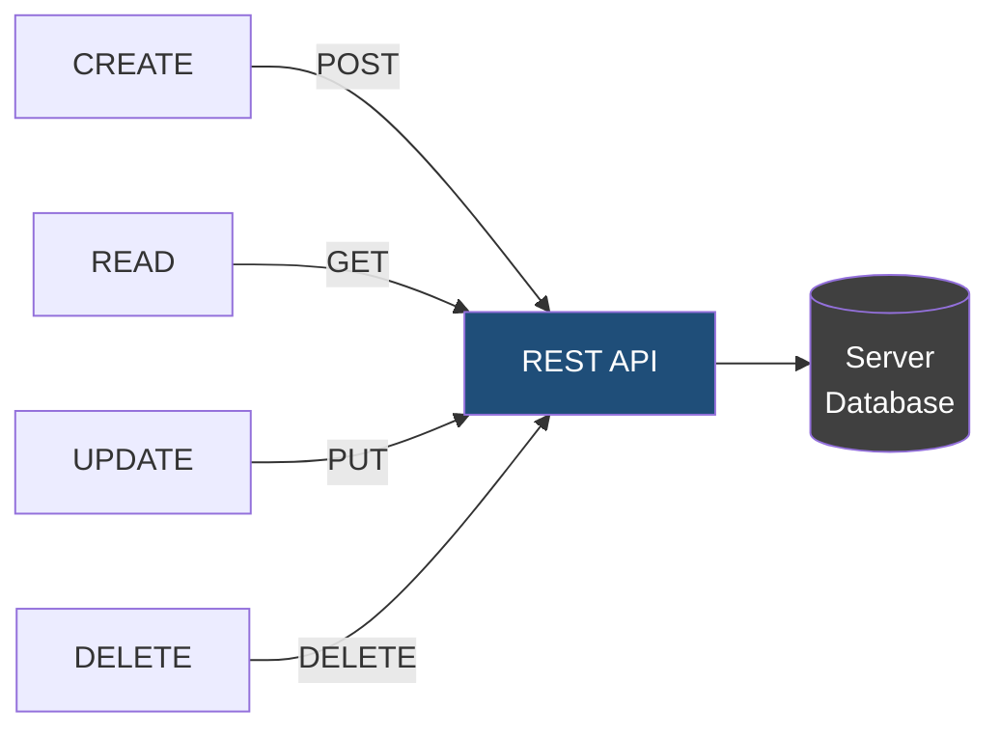
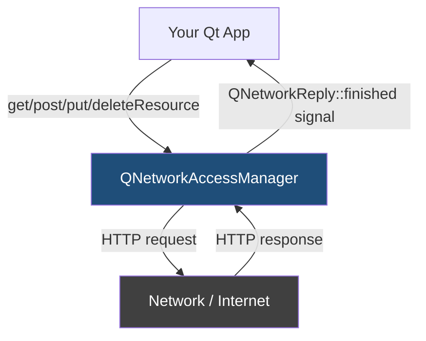
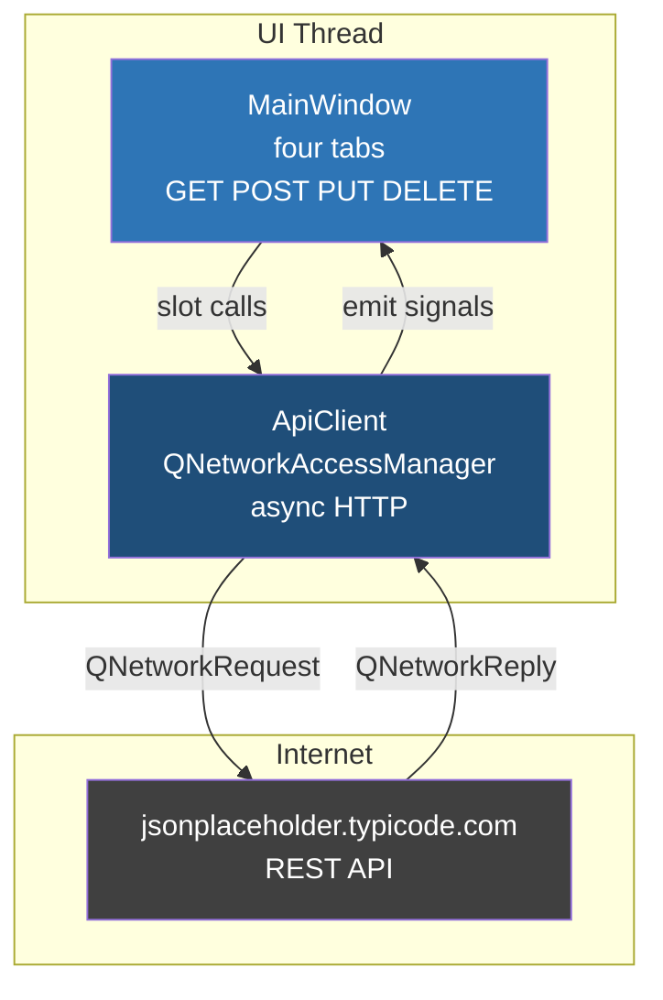
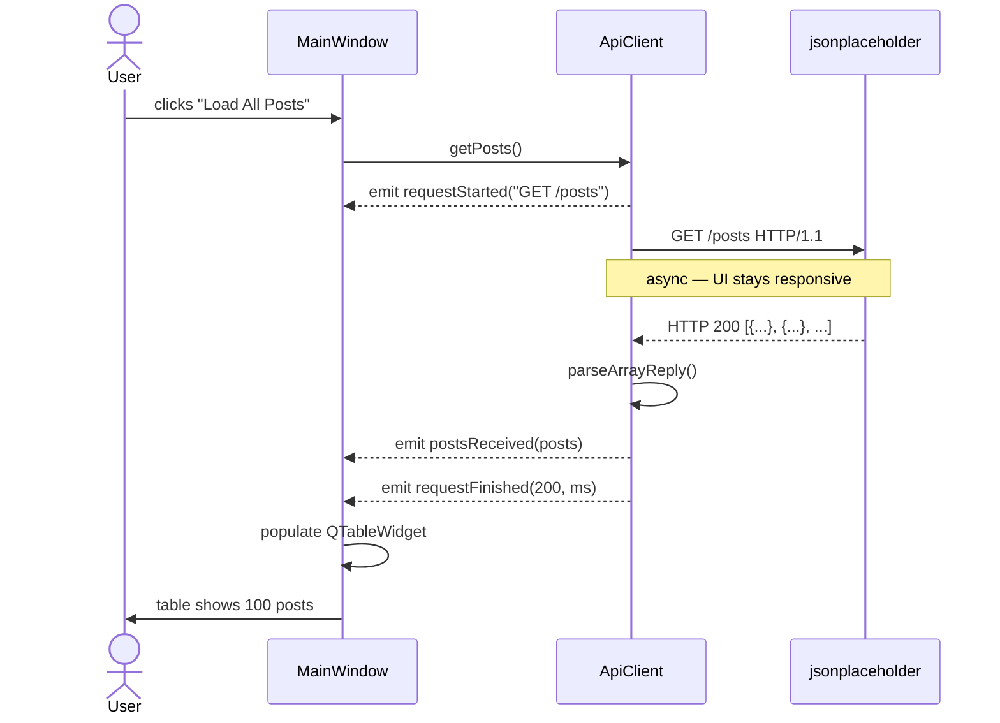

# Qt HTTP REST Demo — QNetworkAccessManager

A Qt6 C++ project demonstrating **HTTP REST API** calls using
`QNetworkAccessManager`. Full CRUD operations (GET, POST, PUT, DELETE)
against a real public API with a tabbed Qt Widgets UI.

---

## 1. Prerequisites

```bash
sudo apt install qt6-base-dev cmake build-essential qtcreator
```

`Qt6::Network` is included in `qt6-base-dev` — no extra packages needed.

**Internet connection required** — the app calls a real REST API.

---

## 2. The API — JSONPlaceholder

```
https://jsonplaceholder.typicode.com
```

A free, public fake REST API for testing. No authentication, no signup.
Returns realistic JSON data for posts, users, comments, todos.

| Endpoint | Method | Description |
|---|---|---|
| `/posts` | GET | List all 100 posts |
| `/posts/{id}` | GET | Get single post |
| `/posts` | POST | Create post (returns fake ID 101) |
| `/posts/{id}` | PUT | Update post |
| `/posts/{id}` | DELETE | Delete post (returns `{}`) |
| `/users` | GET | List all 10 users |

---

## 3. What Is REST?

REST (Representational State Transfer) is the standard pattern for
web APIs. It maps HTTP methods to CRUD operations:



| HTTP Method | CRUD | SQL equivalent |
|---|---|---|
| GET | Read | SELECT |
| POST | Create | INSERT |
| PUT | Update (full) | UPDATE |
| PATCH | Update (partial) | UPDATE (partial) |
| DELETE | Delete | DELETE |

---

## 4. QNetworkAccessManager — How It Works



**Key rules:**
- Create ONE `QNetworkAccessManager` per application — reuse it
- All requests are **asynchronous** — UI never blocks
- `get()`, `post()`, `put()`, `deleteResource()` return `QNetworkReply*`
- Connect `QNetworkReply::finished` to read the response

```cpp
// Create once — reuse for all requests
m_nam = new QNetworkAccessManager(this);

// Make a GET request
QNetworkReply* reply = m_nam->get(request);

// Connect finished signal to handler
connect(reply, &QNetworkReply::finished, this, [this, reply]() {
    QByteArray data = reply->readAll();
    reply->deleteLater();   // always clean up!
});
```

---

## 5. Project Structure

```
qt_http_demo/
├── CMakeLists.txt
├── main.cpp
├── apiclient.h/.cpp    # MODEL — wraps QNAM, all HTTP logic
└── mainwindow.h/.cpp   # VIEW  — tabbed UI for all operations
```

No Presenter class here — the app is simple enough that `MainWindow`
handles both presentation and view logic directly.

---

## 6. Architecture



---

## 7. Building a Request

```cpp
QNetworkRequest ApiClient::buildRequest(const QString& path) const {
    QNetworkRequest request(QUrl(BASE_URL + path));

    // Set Content-Type header — required for POST/PUT with JSON body
    request.setHeader(QNetworkRequest::ContentTypeHeader,
                      "application/json");

    // Timeout — abort if no response within 10 seconds
    request.setTransferTimeout(10000);

    return request;
}
```

---

## 8. The Four HTTP Operations

### GET — Read data

```cpp
// No body — just a URL
QNetworkReply* reply = m_nam->get(buildRequest("/posts"));

connect(reply, &QNetworkReply::finished, this, [this, reply]() {
    QByteArray data = reply->readAll();
    QJsonDocument doc = QJsonDocument::fromJson(data);
    QJsonArray posts = doc.array();
    emit postsReceived(posts);
    reply->deleteLater();
});
```

### POST — Send data to create

```cpp
// Build JSON payload
QJsonObject payload;
payload["title"]  = title;
payload["body"]   = body;
payload["userId"] = userId;
QByteArray data = QJsonDocument(payload).toJson(QJsonDocument::Compact);

// POST with body
QNetworkReply* reply = m_nam->post(buildRequest("/posts"), data);
```

### PUT — Send data to update

```cpp
QJsonObject payload;
payload["id"]    = id;
payload["title"] = newTitle;
payload["body"]  = newBody;
QByteArray data = QJsonDocument(payload).toJson(QJsonDocument::Compact);

QNetworkReply* reply = m_nam->put(
    buildRequest(QString("/posts/%1").arg(id)), data);
```

### DELETE — Remove a resource

```cpp
// No body — just the URL with the ID
QNetworkReply* reply = m_nam->deleteResource(
    buildRequest(QString("/posts/%1").arg(id)));
```

---

## 9. Reading the Response

```cpp
// Check for network errors (connection refused, timeout, etc.)
if (reply->error() != QNetworkReply::NoError) {
    emit errorOccurred(reply->errorString());
    reply->deleteLater();
    return;
}

// Get HTTP status code (200, 201, 404, 500, etc.)
int status = reply->attribute(
    QNetworkRequest::HttpStatusCodeAttribute).toInt();

// Read body
QByteArray data = reply->readAll();

// Parse JSON
QJsonDocument doc = QJsonDocument::fromJson(data);
QJsonObject obj = doc.object();    // for single item
QJsonArray arr  = doc.array();     // for list

// ALWAYS delete the reply when done
reply->deleteLater();
```

---

## 10. Signal Flow — GET /posts



---

## 11. Error Handling

Two types of errors to handle:

```cpp
// Type 1 — Network error (no connection, timeout, DNS fail)
if (reply->error() != QNetworkReply::NoError) {
    emit errorOccurred(reply->errorString());
    // e.g. "Connection refused", "Host not found"
}

// Type 2 — HTTP error (server returned 4xx or 5xx)
int status = reply->attribute(
    QNetworkRequest::HttpStatusCodeAttribute).toInt();
if (status >= 400) {
    emit errorOccurred(QString("HTTP %1").arg(status));
    // e.g. 404 Not Found, 500 Internal Server Error
}
```

---

## 12. HTTP Status Codes

| Code | Meaning | When you see it |
|---|---|---|
| 200 | OK | Successful GET, PUT, DELETE |
| 201 | Created | Successful POST |
| 204 | No Content | DELETE with no body |
| 400 | Bad Request | Invalid JSON in body |
| 401 | Unauthorized | Missing auth token |
| 404 | Not Found | Wrong endpoint or ID |
| 429 | Too Many Requests | Rate limit hit |
| 500 | Server Error | API bug |

---

## 13. CMakeLists — Network Module

```cmake
find_package(Qt6 REQUIRED COMPONENTS Core Widgets Network)

target_link_libraries(qt_http_demo PRIVATE
    Qt6::Core
    Qt6::Widgets
    Qt6::Network    # QNetworkAccessManager, QNetworkReply, QNetworkRequest
)
```

Same `Qt6::Network` module used in the TCP/UDP demos —
it covers all networking: HTTP, TCP, UDP, SSL, WebSocket.

---

## 14. Build & Run

**In Qt Creator:**
1. Copy all files into `qt_http_demo/` project folder
2. Right-click → **Run CMake**
3. `Ctrl+B` then `Ctrl+R`
4. Make sure you have an internet connection

**From terminal:**
```bash
mkdir build && cd build
cmake ..
cmake --build .
./qt_http_demo
```

---

## 15. What This Covers

| Concept | Where |
|---|---|
| `QNetworkAccessManager` — one per app | `ApiClient` constructor |
| `QNetworkRequest` — URL + headers + timeout | `buildRequest()` |
| `m_nam->get()` — async GET | `getPosts()`, `getPost()`, `getUsers()` |
| `m_nam->post()` — POST with JSON body | `createPost()` |
| `m_nam->put()` — PUT with JSON body | `updatePost()` |
| `m_nam->deleteResource()` — DELETE | `deletePost()` |
| `QNetworkReply::finished` signal | All handlers |
| `reply->readAll()` — read response body | `parseReply()` |
| HTTP status code from reply | `requestFinished()` |
| `reply->deleteLater()` — memory cleanup | All handlers |
| `QJsonDocument` — parse JSON response | `parseReply()`, `parseArrayReply()` |
| `QJsonDocument::toJson()` — build JSON body | `createPost()`, `updatePost()` |
| Lambda slots for per-reply context | All reply connections |
