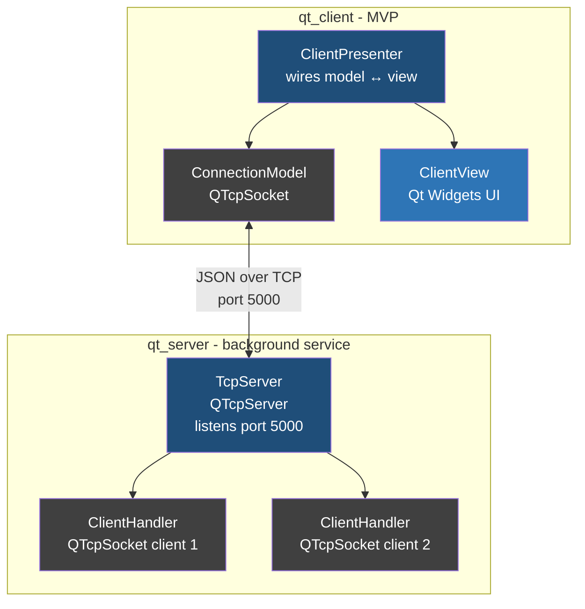
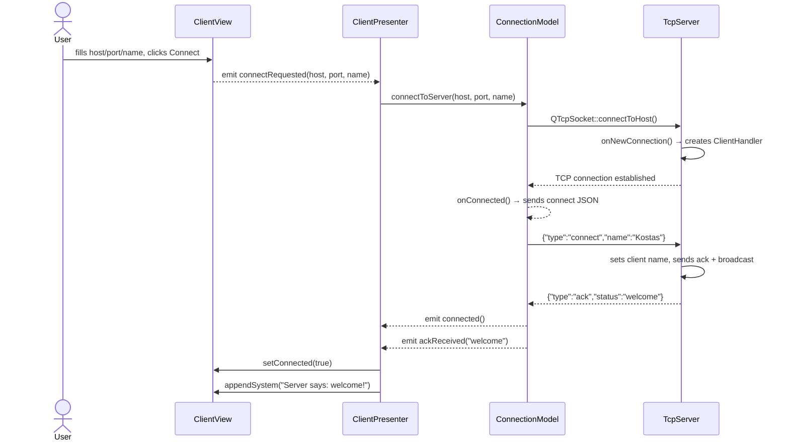
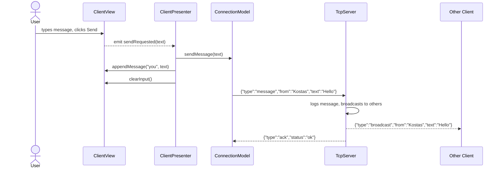

# Qt Networking Demo — TCP Server & Client

A Qt6 C++ project demonstrating **TCP networking** using `QTcpServer` and
`QTcpSocket`. Two separate applications — a headless background service
(server) and a Qt Widgets chat client (MVP pattern).

---

## 1. Prerequisites

```bash
sudo apt install qt6-base-dev cmake build-essential qtcreator
```

Qt6 Network module is included in `qt6-base-dev` — no extra packages needed.

---

## 2. Project Structure

```
qt_networking_demo/
├── qt_server/                  ← background service (no UI)
│   ├── CMakeLists.txt
│   ├── main.cpp                # QCoreApplication entry point
│   ├── tcpserver.h/.cpp        # QTcpServer — accepts connections
│   ├── clienthandler.h/.cpp    # owns one QTcpSocket per client
│   └── protocol.h              # shared JSON message builder/parser
│
└── qt_client/                  ← Qt Widgets chat UI (MVP)
    ├── CMakeLists.txt
    ├── main.cpp
    ├── mainwindow.h/.cpp        # shell — creates MVP layers
    ├── connectionmodel.h/.cpp  # MODEL — owns QTcpSocket
    ├── clientview.h/.cpp       # VIEW  — UI widgets
    ├── clientpresenter.h/.cpp  # PRESENTER — wires model ↔ view
    └── protocol.h              # same protocol header (copy)
```

---

## 3. Architecture



---

## 4. The Protocol — JSON over TCP

Every message is a **JSON object followed by `\n`** (newline delimiter).

```
{"type":"connect","name":"Kostas"}\n
{"type":"message","from":"Kostas","text":"Hello"}\n
{"type":"broadcast","from":"server","text":"Kostas joined"}\n
{"type":"ack","status":"ok"}\n
{"type":"ping"}\n
{"type":"pong"}\n
```

### Why newline framing?

TCP is a **stream protocol** — it has no concept of message boundaries.
If you send 200 bytes, the receiver might get 100 bytes in one read and
100 in the next. The newline delimiter solves this:

```cpp
// Accumulate bytes until we see '\n'
m_buffer += m_socket->readAll();
while (m_buffer.contains('\n')) {
    int idx = m_buffer.indexOf('\n');
    QByteArray line = m_buffer.left(idx);   // one complete message
    m_buffer = m_buffer.mid(idx + 1);       // keep remainder
    process(line);
}
```

This pattern appears in every TCP application — HTTP, SMTP, Redis protocol.

---

## 5. Key Qt Networking Classes

### QTcpServer (server side)

```cpp
QTcpServer* server = new QTcpServer(this);
server->listen(QHostAddress::Any, 5000);

connect(server, &QTcpServer::newConnection, this, [=]() {
    QTcpSocket* socket = server->nextPendingConnection();
    // socket is now a connected client
});
```

### QTcpSocket (both sides)

```cpp
// Connect to server
QTcpSocket* socket = new QTcpSocket(this);
socket->connectToHost("127.0.0.1", 5000);

// Send data
socket->write(data);

// Receive data (async — fires when data arrives)
connect(socket, &QTcpSocket::readyRead, this, [=]() {
    QByteArray data = socket->readAll();
});
```

### QCoreApplication (server — no GUI)

```cpp
// Server uses QCoreApplication — no widgets, no window
// Just the Qt event loop for async I/O
QCoreApplication app(argc, argv);
return app.exec();  // blocks, handles all socket events
```

---

## 6. Signal Flow

### Client connects to server



### Client sends a message



---

## 7. Create the Projects in Qt Creator

**Server — Qt Console Application:**
1. `File → New Project → Application (Qt) → Qt Console Application`
2. Name: `qt_server`, CMake → Finish
3. Replace generated files with files from `qt_server/` folder

**Client — Qt Widgets Application:**
1. `File → New Project → Application (Qt) → Qt Widgets Application`
2. Name: `qt_client`, CMake → Finish
3. Replace generated files with files from `qt_client/` folder
4. Add all new files to `PROJECT_SOURCES` in CMakeLists.txt

---

## 8. Build & Run

**Step 1 — Build both in Qt Creator** (`Ctrl+B` for each)

**Step 2 — Start the server in a terminal:**
```bash
cd ~/Desktop/Programming/QTprojects/qt_server/build/Desktop-Debug
./qt_server
```

Expected output:
```
========================================
  Qt TCP Server — networking demo
========================================
20:30:01  Server listening on port 5000
20:30:01  Waiting for connections...
```

**Step 3 — Run the client from Qt Creator** (`Ctrl+R`)

**Step 4 — Connect:**
- Host: `127.0.0.1`
- Port: `5000`
- Name: your name
- Click **Connect**

**Step 5 — Open a second client** (run `./qt_client` from terminal) to test multi-client broadcasting.

---

## 9. CMakeLists.txt — Network Module

Both projects link `Qt6::Network`:

```cmake
find_package(Qt6 REQUIRED COMPONENTS Core Network)       # server
find_package(Qt6 REQUIRED COMPONENTS Core Widgets Network) # client

target_link_libraries(qt_server PRIVATE Qt6::Core Qt6::Network)
target_link_libraries(qt_client PRIVATE Qt6::Core Qt6::Widgets Qt6::Network)
```

`Qt6::Network` provides: `QTcpServer`, `QTcpSocket`, `QUdpSocket`,
`QNetworkAccessManager` (HTTP), `QSslSocket`.

---

## 10. What This Covers

| Concept | Where |
|---|---|
| `QTcpServer` — listen for connections | `TcpServer` |
| `QTcpSocket` — send/receive data | `ClientHandler`, `ConnectionModel` |
| `QCoreApplication` — headless event loop | `qt_server/main.cpp` |
| TCP stream buffering with `\n` framing | `ClientHandler::onReadyRead()` |
| JSON message protocol | `protocol.h` |
| Multiple simultaneous clients | `TcpServer::m_clients` list |
| MVP pattern on networked app | Full client layer |
| `Qt6::Network` CMake module | Both `CMakeLists.txt` |
