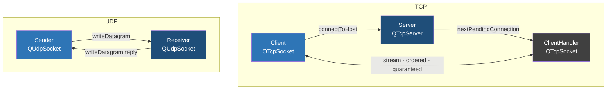
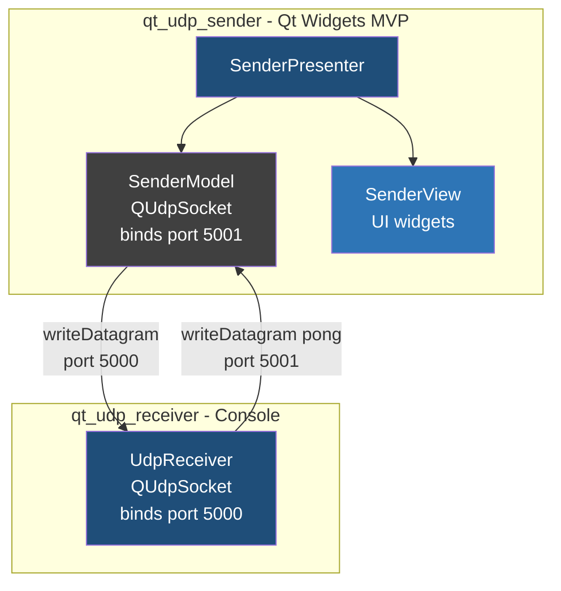
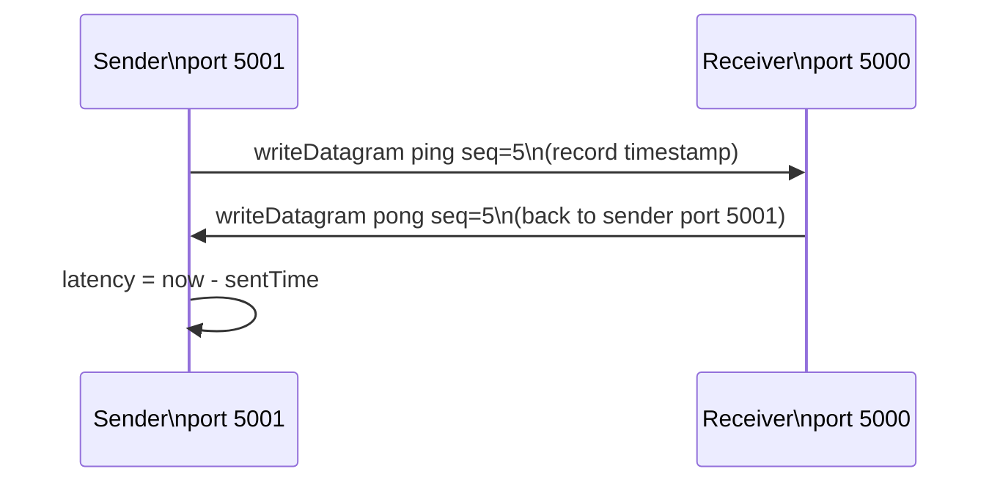
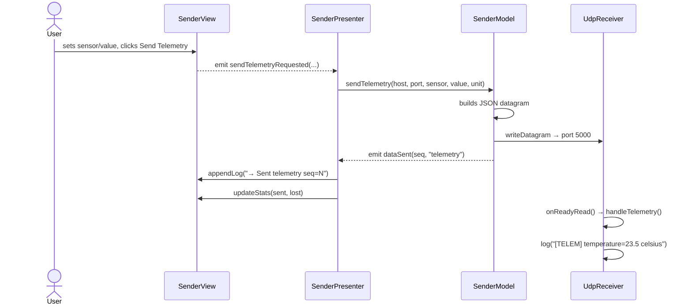

# Qt UDP Demo — Sender & Receiver

A Qt6 C++ project demonstrating **UDP networking** using `QUdpSocket`.
Two separate applications — a Qt Widgets sender UI and a headless console receiver.

---

## 1. Prerequisites

```bash
sudo apt install qt6-base-dev cmake build-essential qtcreator
```

Qt6 Network module is included in `qt6-base-dev` — no extra packages needed.

---

## 2. Project Structure

```
qt_networking_demo/
├── qt_server/              ← TCP (done)
├── qt_client/              ← TCP (done)
├── qt_udp_sender/          ← UDP Widgets sender (MVP)
│   ├── CMakeLists.txt
│   ├── main.cpp
│   ├── mainwindow.h/.cpp
│   ├── sendermodel.h/.cpp  # MODEL — owns QUdpSocket
│   ├── senderview.h/.cpp   # VIEW  — UI widgets
│   ├── senderpresenter.h/.cpp # PRESENTER
│   └── udpprotocol.h       # shared JSON datagram builder
└── qt_udp_receiver/        ← UDP console receiver
    ├── CMakeLists.txt
    ├── main.cpp
    ├── udpreceiver.h/.cpp  # listens, logs, replies to ping
    └── udpprotocol.h       # shared JSON datagram parser
```

---

## 3. TCP vs UDP — The Fundamental Difference



| Aspect | TCP | UDP |
|---|---|---|
| Connection required | Yes | No |
| Delivery guaranteed | Yes | No |
| Order guaranteed | Yes | No |
| Speed / latency | Slower | Faster |
| Server class needed | `QTcpServer` | No — just `QUdpSocket` |
| Send method | `write()` | `writeDatagram(data, addr, port)` |
| Receive method | `readAll()` | `readDatagram(buf, size, &addr, &port)` |
| Message framing | Manual (`\n` delimiter) | None — each datagram = one message |
| Use cases | Commands, files, chat | Audio, video, telemetry, radar |

---

## 4. QUdpSocket — How It Works

### No server class needed

With TCP you need `QTcpServer` to accept connections.
With UDP there are no connections — just bind to a port and start reading:

```cpp
// TCP receiver needs TWO classes
QTcpServer* server = new QTcpServer(this);
server->listen(QHostAddress::Any, 5000);
// ... then nextPendingConnection() gives QTcpSocket

// UDP receiver needs ONE class
QUdpSocket* socket = new QUdpSocket(this);
socket->bind(QHostAddress::Any, 5000);  // that's it
connect(socket, &QUdpSocket::readyRead, this, &MyClass::onReadyRead);
```

### writeDatagram — address + port every time

With TCP you connect once, then just `write()`.
With UDP you specify the destination on every send:

```cpp
// TCP — connect once, write many
socket->connectToHost("127.0.0.1", 5000);
socket->write("hello");
socket->write("world");  // same connection

// UDP — destination per datagram
socket->writeDatagram("hello", QHostAddress("127.0.0.1"), 5000);
socket->writeDatagram("world", QHostAddress("127.0.0.1"), 5000);
// could even send to different addresses each time
```

### readDatagram — gets sender address automatically

```cpp
void onReadyRead() {
    while (m_socket->hasPendingDatagrams()) {
        QByteArray   data;
        QHostAddress senderAddr;
        quint16      senderPort;

        data.resize(m_socket->pendingDatagramSize());
        m_socket->readDatagram(data.data(), data.size(),
                               &senderAddr, &senderPort);

        // senderAddr + senderPort tell you WHO sent this
        // useful for sending a reply back
    }
}
```

### No buffering needed

With TCP you buffer until `\n` because the stream may split messages.
With UDP each `readDatagram()` call returns exactly one complete datagram:

```cpp
// TCP — must buffer
m_buffer += m_socket->readAll();
while (m_buffer.contains('\n')) { ... }  // reassemble messages

// UDP — no buffering needed
// pendingDatagramSize() = exact size of next datagram
data.resize(m_socket->pendingDatagramSize());
m_socket->readDatagram(data.data(), data.size(), ...);
// data = one complete message, always
```

---

## 5. Architecture



**Port layout:**
- `5000` — receiver listens here, accepts all datagrams
- `5001` — sender binds here, receives pong replies

---

## 6. Packet Loss Detection

UDP packets can be lost, duplicated, or arrive out of order.
The receiver detects gaps using sequence numbers:

```cpp
int seq = msg["seq"].toInt(-1);
if (seq >= 0 && m_lastSeq >= 0) {
    int expected = m_lastSeq + 1;
    if (seq > expected) {
        int lost = seq - expected;
        m_lostCount += lost;
        log(QString("PACKET LOSS: expected %1, got %2").arg(expected).arg(seq));
    }
}
if (seq >= 0) m_lastSeq = seq;
```

On a local network (127.0.0.1) you will see zero loss. Over WiFi or
a real network you may start to see drops — especially with the auto-send
at high frequency. This is by design and mirrors real sensor/telemetry systems.

---

## 7. Ping / Pong — Latency Measurement

The sender measures round-trip latency:



```cpp
// Sender — record time before sending
m_pingSentTime = QDateTime::currentMSecsSinceEpoch();
socket->writeDatagram(UdpProtocol::makePing(seq), addr, 5000);

// Sender — on pong received
int latencyMs = QDateTime::currentMSecsSinceEpoch() - m_pingSentTime;
```

On localhost you should see 0-1ms. Over LAN 1-5ms. Over internet 20-200ms.

---

## 8. Signal Flow — Sending Telemetry



---

## 9. Create Projects in Qt Creator

**Sender — Qt Widgets Application:**
1. `File → New Project → Qt Widgets Application`
2. Name: `qt_udp_sender`, location: `qt_networking_demo/`
3. CMake → Finish
4. Replace/add all files from `qt_udp_sender/` folder

**Receiver — Qt Console Application:**
1. `File → New Project → Qt Console Application`
2. Name: `qt_udp_receiver`, location: `qt_networking_demo/`
3. CMake → Finish
4. Replace/add all files from `qt_udp_receiver/` folder

---

## 10. Build & Run

**Step 1 — Build both in Qt Creator** (`Ctrl+B` for each)

**Step 2 — Start the receiver in terminal:**
```bash
cd ~/Desktop/Programming/QTprojects/qt_networking_demo/qt_udp_receiver/build/Desktop-Debug
./qt_udp_receiver
```

Expected output:
```
========================================
  Qt UDP Receiver — networking demo
========================================
20:30:01.123  Listening for UDP datagrams on port 5000
20:30:01.123  Waiting for packets...
```

**Step 3 — Run the sender from Qt Creator** (`Ctrl+R`)

**Step 4 — Send packets:**
- Click **Send** to send a single data packet
- Click **Send Telemetry** to send a sensor reading
- Click **Send Ping** to measure latency
- Click **Start Auto Send** to stream telemetry at 500ms intervals

**Step 5 — Watch the receiver terminal** output update in real time.

---

## 11. CMakeLists — Network Module

```cmake
find_package(Qt6 REQUIRED COMPONENTS Core Network)         # receiver
find_package(Qt6 REQUIRED COMPONENTS Core Widgets Network) # sender

target_link_libraries(qt_udp_receiver PRIVATE Qt6::Core Qt6::Network)
target_link_libraries(qt_udp_sender   PRIVATE Qt6::Core Qt6::Widgets Qt6::Network)
```

`QUdpSocket` lives in `Qt6::Network` — same module as `QTcpSocket`.

---

## 12. What This Covers

| Concept | Where |
|---|---|
| `QUdpSocket::bind()` — become a receiver | `UdpReceiver::start()` |
| `QUdpSocket::writeDatagram()` — send | `SenderModel::sendData()` |
| `QUdpSocket::readDatagram()` — receive with sender info | `UdpReceiver::onReadyRead()` |
| `hasPendingDatagrams()` loop | Both sides |
| No buffering needed (datagram = message) | vs TCP `\n` framing |
| Sequence number loss detection | `UdpReceiver::onReadyRead()` |
| Ping/pong latency measurement | `SenderModel` + `UdpReceiver` |
| Auto-send timer (sensor simulation) | `SenderModel::startAutoSend()` |
| `QRandomGenerator` (Qt6 replacement for `qrand`) | `SenderModel::onAutoSendTick()` |
| MVP pattern on UDP app | Full sender layer |
