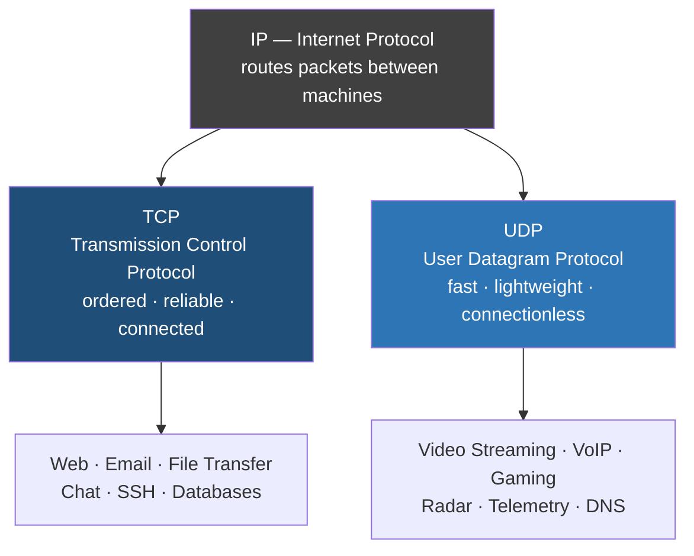
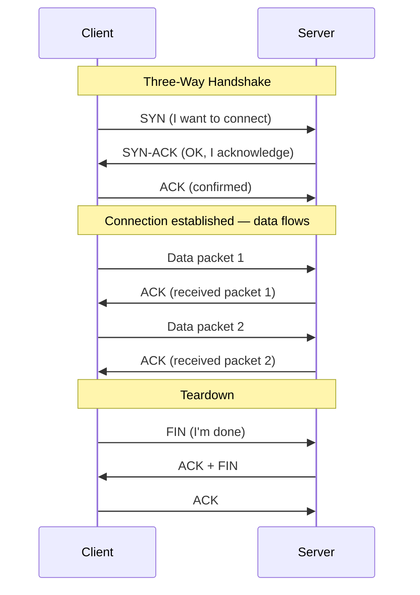
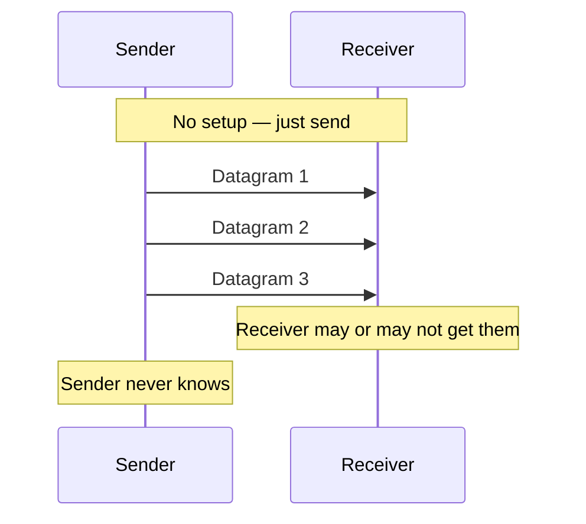
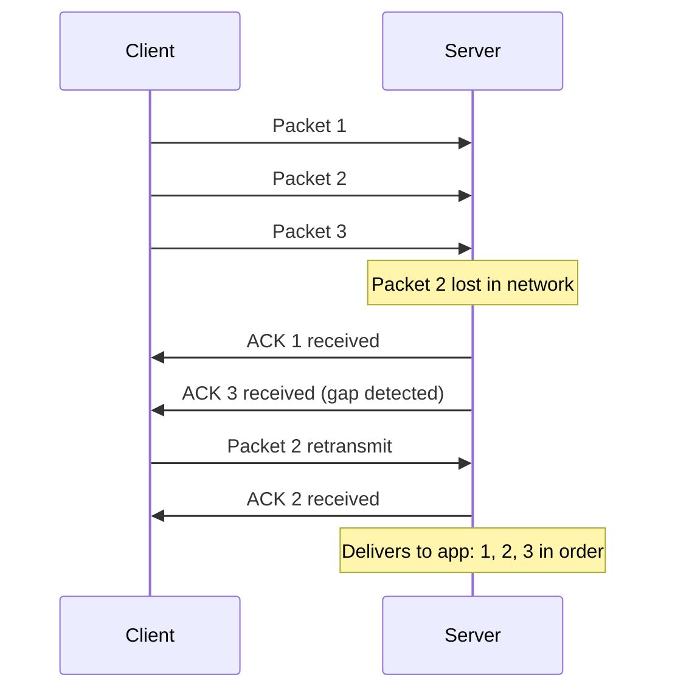
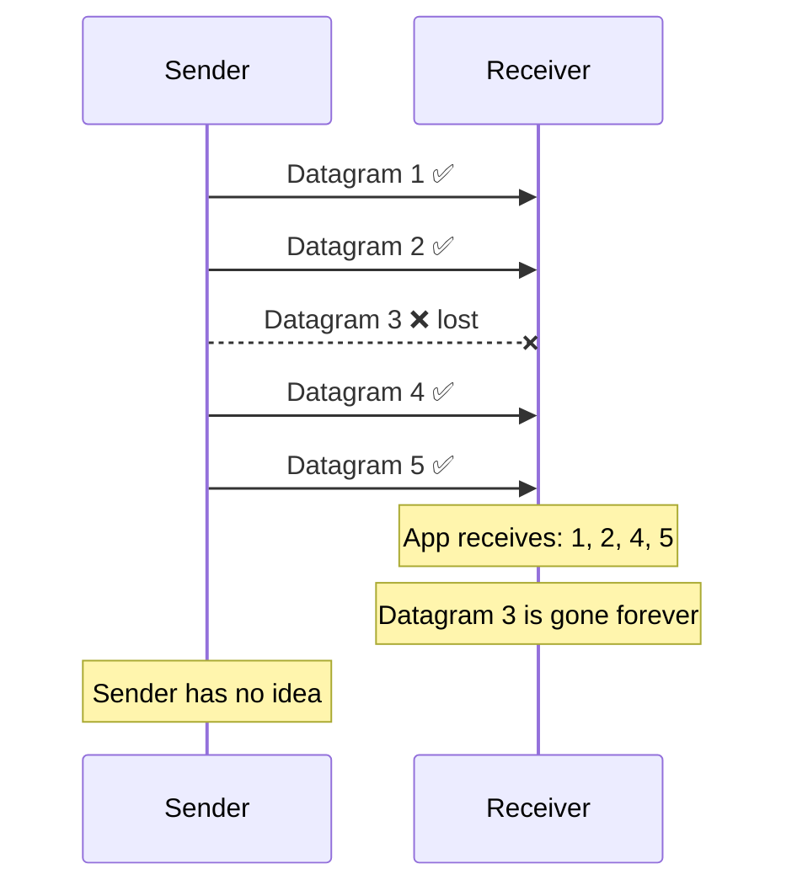
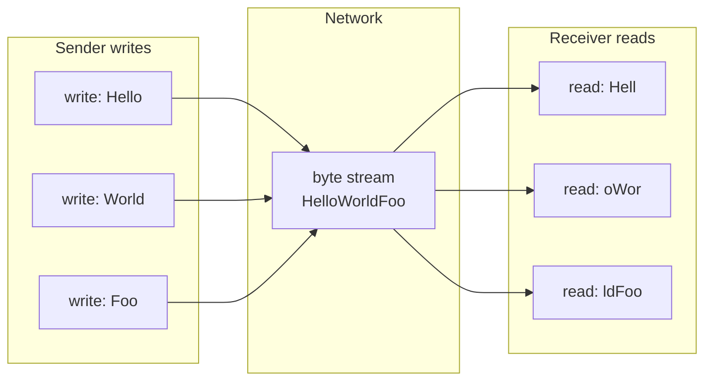
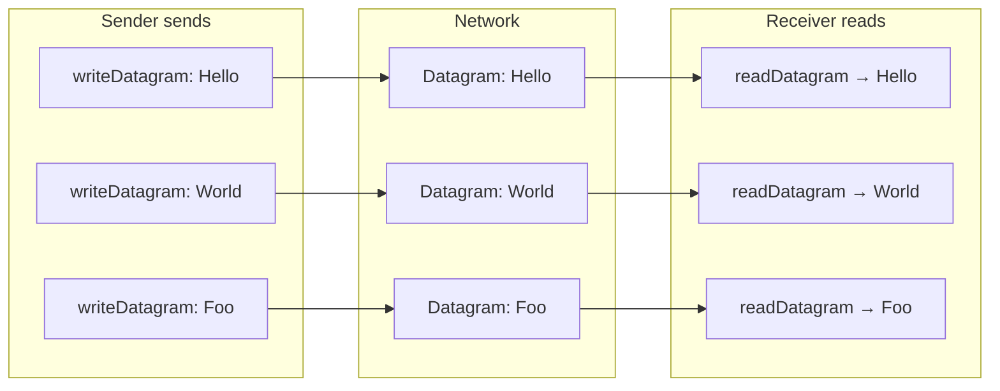
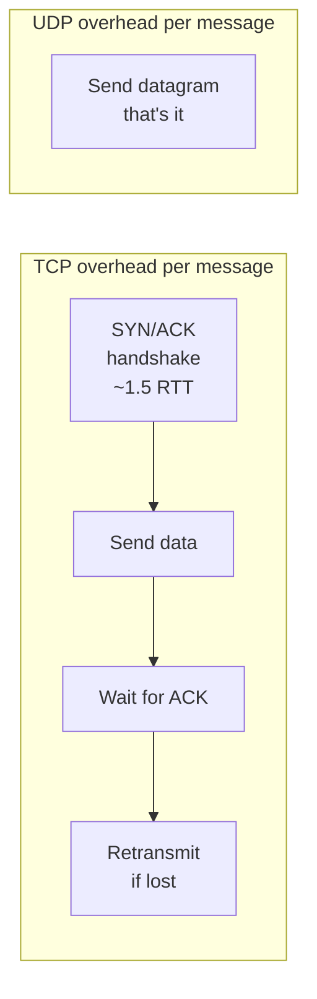
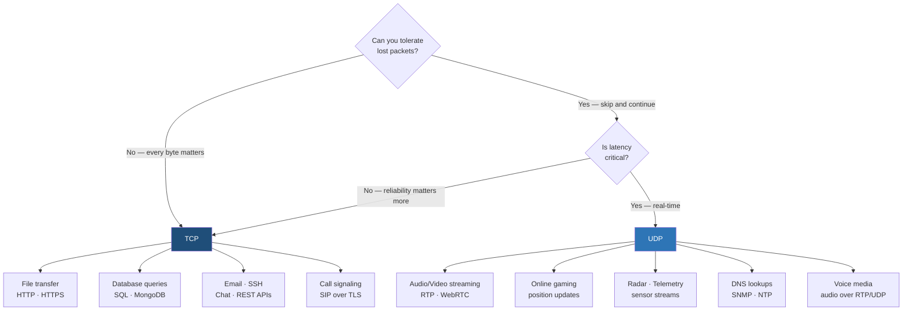
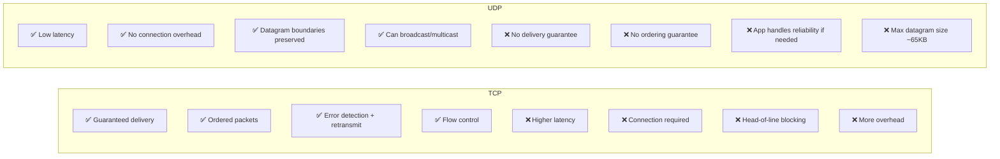

# TCP vs UDP — Complete Guide

A detailed comparison of the two fundamental transport protocols,
with diagrams, code examples, and real-world use cases.

---

## 1. The Big Picture



Both TCP and UDP sit on top of IP. They solve the same basic problem —
getting data from one machine to another — but with completely different
trade-offs.

---

## 2. Connection Model

### TCP — Three-Way Handshake

Before any data flows, TCP establishes a connection:



**Cost:** ~1.5 round trips before first byte of data.
**Benefit:** Both sides know the connection is alive and ready.

---

### UDP — No Handshake



**Cost:** Zero. First packet is sent immediately.
**Trade-off:** No confirmation, no state, no guarantees.

---

## 3. Reliability & Ordering

### TCP — Guaranteed Delivery



TCP guarantees:
- Every packet arrives (retransmits if lost)
- Packets delivered to application **in order**
- No duplicates

---

### UDP — Fire and Forget



UDP provides:
- No delivery guarantee
- No ordering guarantee
- No duplicate protection
- **Application must handle this if needed**

---

## 4. Data Model — Stream vs Datagram

This is the most important difference for programming.

### TCP — Byte Stream



TCP has **no message boundaries**. The receiver has no idea where
one `write()` ends and the next begins. You must frame your own messages
(e.g. newline delimiter, length prefix).

```cpp
// Sender writes two messages
socket->write("Hello\n");
socket->write("World\n");

// Receiver might get in ONE read:
// "Hello\nWorld\n"
// OR in two reads:
// "Hell" then "o\nWorld\n"
// You MUST buffer and split on '\n'
```

---

### UDP — Datagrams



UDP **preserves message boundaries**. One `writeDatagram()` = one
`readDatagram()`. No buffering or framing needed.

```cpp
// Sender
socket->writeDatagram("Hello", addr, port);
socket->writeDatagram("World", addr, port);

// Receiver — each call returns exactly one datagram
data.resize(socket->pendingDatagramSize());
socket->readDatagram(data.data(), data.size(), ...);
// data == "Hello" (complete, no partial reads)
```

---

## 5. Qt API Comparison

### TCP

```cpp
// ── Server side ──────────────────────────────────────────
QTcpServer* server = new QTcpServer(this);
server->listen(QHostAddress::Any, 5000);

connect(server, &QTcpServer::newConnection, this, [=]() {
    QTcpSocket* client = server->nextPendingConnection();
    // client is now a connected socket for this specific client
});

// ── Client side ──────────────────────────────────────────
QTcpSocket* socket = new QTcpSocket(this);
socket->connectToHost("127.0.0.1", 5000);  // must connect first

socket->write("Hello\n");                  // send

connect(socket, &QTcpSocket::readyRead, this, [=]() {
    m_buffer += socket->readAll();          // must buffer!
    while (m_buffer.contains('\n')) { ... } // reassemble messages
});
```

### UDP

```cpp
// ── Receiver side ────────────────────────────────────────
QUdpSocket* socket = new QUdpSocket(this);
socket->bind(QHostAddress::Any, 5000);     // no QUdpServer needed

connect(socket, &QUdpSocket::readyRead, this, [=]() {
    while (socket->hasPendingDatagrams()) {
        QByteArray   data;
        QHostAddress senderAddr;
        quint16      senderPort;
        data.resize(socket->pendingDatagramSize());
        socket->readDatagram(data.data(), data.size(),
                             &senderAddr, &senderPort);
        // data = one complete message, no buffering needed
        // senderAddr/senderPort = who sent it
    }
});

// ── Sender side ──────────────────────────────────────────
QUdpSocket* socket = new QUdpSocket(this);
// no connect needed — just send directly
socket->writeDatagram("Hello", QHostAddress("127.0.0.1"), 5000);
```

---

## 6. Performance Characteristics



| Metric | TCP | UDP |
|---|---|---|
| Connection setup | ~1.5 round trips | Zero |
| Per-packet overhead | ACK required | None |
| Retransmission | Automatic | None |
| Head-of-line blocking | Yes — slow packet blocks all | No |
| Typical latency | Higher | Lower |
| Throughput on good network | Similar | Similar |
| Throughput on lossy network | Degrades (retransmits) | Constant (packets dropped) |

**Head-of-line blocking** is a key TCP problem for real-time data:
if packet 5 is lost, packets 6, 7, 8 are held back until 5 is
retransmitted and received — even though 6, 7, 8 are already there.
For audio/video this causes stuttering. UDP just skips 5 and plays on.

---

## 7. When to Use Which



---

## 8. Real-World Industry Examples

| Domain | Protocol | Why |
|---|---|---|
| VoIP call signaling (SIP) | TCP/TLS | SIP must be reliable — call setup can't be lost |
| VoIP call audio (RTP) | UDP | RTP audio — latency over reliability |
| Radar data stream | UDP | High rate, real-time — old frames are useless |
| SCADA sensor telemetry | UDP | High frequency, tolerable loss |
| Industrial PLC commands | TCP | Commands must arrive — machine safety |
| OTA firmware update | TCP | Every byte must arrive correctly |
| Vehicle position broadcast | UDP | Latest position matters, old ones don't |
| DNS query | UDP | Single request/response — fast, no connection |
| HTTPS web traffic | TCP | Every byte of the page must arrive |
| Video conference media | UDP | Latency over perfection — QUIC also UDP-based |

---

## 9. Summary Cheat Sheet



| | TCP | UDP |
|---|---|---|
| Qt server class | `QTcpServer` | None needed |
| Qt socket class | `QTcpSocket` | `QUdpSocket` |
| Send method | `write(data)` | `writeDatagram(data, addr, port)` |
| Receive method | `readAll()` + buffer | `readDatagram()` — no buffer |
| Message framing | Manual (`\n` or length prefix) | Built-in (datagram = message) |
| Know who sent it | From connection | From `readDatagram(&addr, &port)` |
| CMake module | `Qt6::Network` | `Qt6::Network` |
