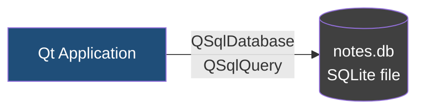
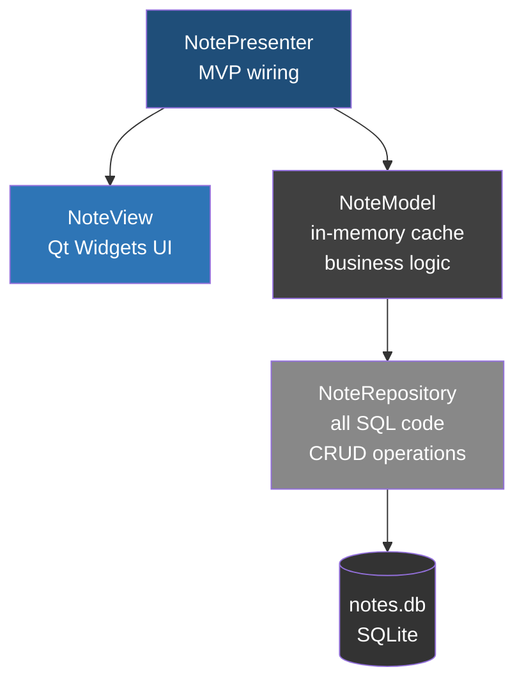
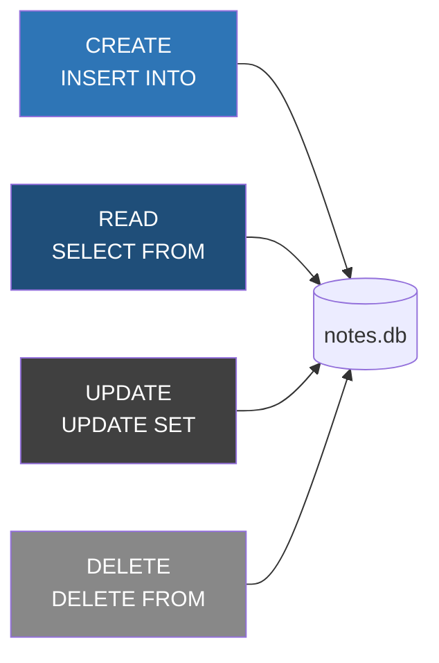
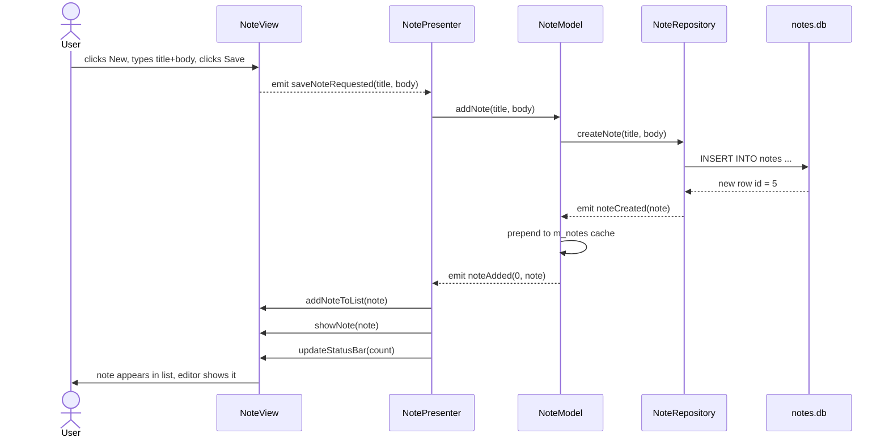

# Qt SQLite Demo — Notes App

A Qt6 C++ notes application demonstrating **persistent data storage**
using `QtSql` + SQLite. Full MVP architecture with a three-layer data
stack: Repository → Model → Presenter → View.

---

## 1. Prerequisites

```bash
sudo apt install qt6-base-dev libqt6sql6-sqlite cmake build-essential qtcreator
```

| Package | Purpose |
|---|---|
| `qt6-base-dev` | Qt6 core + Widgets |
| `libqt6sql6-sqlite` | SQLite driver for Qt6 — required at runtime |
| `cmake` | Build system |

---

## 2. What Is SQLite?

SQLite is a **file-based relational database** — no server, no daemon,
no configuration. The entire database is one `.db` file on disk.



Perfect for desktop apps, embedded systems, and local data persistence.
Used by Firefox, Android, iOS, and countless others.

---

## 3. Architecture — Three-Layer Data Stack

This project introduces the **Repository pattern** — a dedicated class
for all database access, sitting below the Model.



| Layer | Class | Responsibility |
|---|---|---|
| View | `NoteView` | UI widgets, user signals |
| Presenter | `NotePresenter` | Wires model ↔ view, application logic |
| Model | `NoteModel` | In-memory cache, search, business rules |
| Repository | `NoteRepository` | All SQL — open, create schema, CRUD |
| Database | `notes.db` | SQLite file on disk |

---

## 4. Key Qt SQL Classes

### QSqlDatabase — connection management

```cpp
// Add a named SQLite connection
QSqlDatabase db = QSqlDatabase::addDatabase("QSQLITE", "my_connection");
db.setDatabaseName("/path/to/notes.db");
db.open();

// Always use named connections when you have multiple databases
// "QSQLITE" = the driver. Others: "QPSQL", "QMYSQL", "QODBC"
```

### QSqlQuery — execute SQL

```cpp
QSqlQuery query(db);

// Simple query
query.exec("SELECT * FROM notes ORDER BY updated_at DESC");
while (query.next()) {
    QString title = query.value("title").toString();
    int     id    = query.value("id").toInt();
}

// Prepared statement — ALWAYS use for user input (SQL injection protection)
query.prepare("INSERT INTO notes (title, body) VALUES (:title, :body)");
query.bindValue(":title", "My Note");
query.bindValue(":body",  "Note content");
query.exec();

// Get last inserted row id
int newId = query.lastInsertId().toInt();
```

### QSqlError — error handling

```cpp
if (!query.exec()) {
    QString error = query.lastError().text();
    qDebug() << "SQL Error:" << error;
}
```

---

## 5. CRUD Operations



### CREATE

```cpp
query.prepare(
    "INSERT INTO notes (title, body, created_at, updated_at) "
    "VALUES (:title, :body, :created_at, :updated_at)"
);
query.bindValue(":title",      "My Note");
query.bindValue(":body",       "Content here");
query.bindValue(":created_at", QDateTime::currentDateTime().toString(Qt::ISODate));
query.bindValue(":updated_at", QDateTime::currentDateTime().toString(Qt::ISODate));
query.exec();
```

### READ

```cpp
query.exec("SELECT id, title, body, created_at, updated_at "
           "FROM notes ORDER BY updated_at DESC");
while (query.next()) {
    Note n;
    n.id    = query.value("id").toInt();
    n.title = query.value("title").toString();
    n.body  = query.value("body").toString();
}
```

### UPDATE

```cpp
query.prepare(
    "UPDATE notes SET title = :title, body = :body, updated_at = :updated_at "
    "WHERE id = :id"
);
query.bindValue(":title",      newTitle);
query.bindValue(":body",       newBody);
query.bindValue(":updated_at", QDateTime::currentDateTime().toString(Qt::ISODate));
query.bindValue(":id",         noteId);
query.exec();
```

### DELETE

```cpp
query.prepare("DELETE FROM notes WHERE id = :id");
query.bindValue(":id", noteId);
query.exec();
```

---

## 6. Schema Creation

```cpp
query.exec(
    "CREATE TABLE IF NOT EXISTS notes ("
    "  id         INTEGER PRIMARY KEY AUTOINCREMENT,"
    "  title      TEXT    NOT NULL,"
    "  body       TEXT    NOT NULL DEFAULT '',"
    "  created_at TEXT    NOT NULL,"
    "  updated_at TEXT    NOT NULL"
    ")"
);
```

`CREATE TABLE IF NOT EXISTS` — safe to call every time the app starts.
Creates the table only if it doesn't already exist.

---

## 7. Database Location

The `.db` file is stored in the user's application data directory:

```cpp
QString dbPath = QStandardPaths::writableLocation(
    QStandardPaths::AppDataLocation) + "/notes.db";
```

On Linux: `~/.local/share/QtTutorial/qt_sql_demo/notes.db`
On Windows: `C:\Users\<user>\AppData\Local\QtTutorial\qt_sql_demo\notes.db`

**Notes persist between app restarts** — this is the key difference
from all previous examples which lost data when closed.

---

## 8. Signal Flow — Creating a Note



---

## 9. Why Prepared Statements?

Never build SQL with string concatenation:

```cpp
// WRONG — SQL injection vulnerability
QString sql = "SELECT * FROM notes WHERE title = '" + userInput + "'";
// If userInput = "'; DROP TABLE notes; --"
// → deletes your entire database

// CORRECT — prepared statement
query.prepare("SELECT * FROM notes WHERE title = :title");
query.bindValue(":title", userInput);
// Qt escapes the input — no injection possible
```

This matters even for local SQLite apps — good habit that carries
directly to production server databases.

---

## 10. CMakeLists — Sql Module

```cmake
find_package(Qt6 REQUIRED COMPONENTS Core Widgets Sql)

target_link_libraries(qt_sql_demo PRIVATE
    Qt6::Core
    Qt6::Widgets
    Qt6::Sql       # QSqlDatabase, QSqlQuery, QSqlError
)
```

Also requires the SQLite driver at runtime:
```bash
sudo apt install libqt6sql6-sqlite
```

---

## 11. Build & Run

**In Qt Creator:**
1. Copy all files into your `qt_sql_demo` project folder
2. Right-click → **Run CMake**
3. `Ctrl+B` then `Ctrl+R`

**From terminal:**
```bash
mkdir build && cd build
cmake ..
cmake --build .
./qt_sql_demo
```

---

## 12. What This Covers

| Concept | Where |
|---|---|
| `QSqlDatabase` — open SQLite connection | `NoteRepository::open()` |
| `CREATE TABLE IF NOT EXISTS` | `NoteRepository::createSchema()` |
| Prepared statements + `bindValue` | All CRUD methods |
| `QSqlQuery::next()` — iterate results | `NoteRepository::getAllNotes()` |
| `lastInsertId()` — get new row id | `NoteRepository::createNote()` |
| `QSqlError` — error handling | All query methods |
| `QStandardPaths` — OS data directory | `main.cpp` + `mainwindow.cpp` |
| Repository pattern | `NoteRepository` class |
| Three-layer data stack | Repo → Model → Presenter |
| In-memory cache | `NoteModel::m_notes` |
| Search/filter without re-querying DB | `NoteModel::search()` |
| Data persists between restarts | SQLite file on disk |
