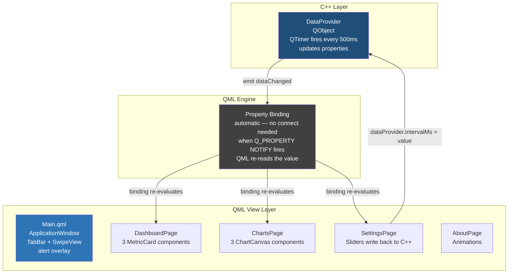
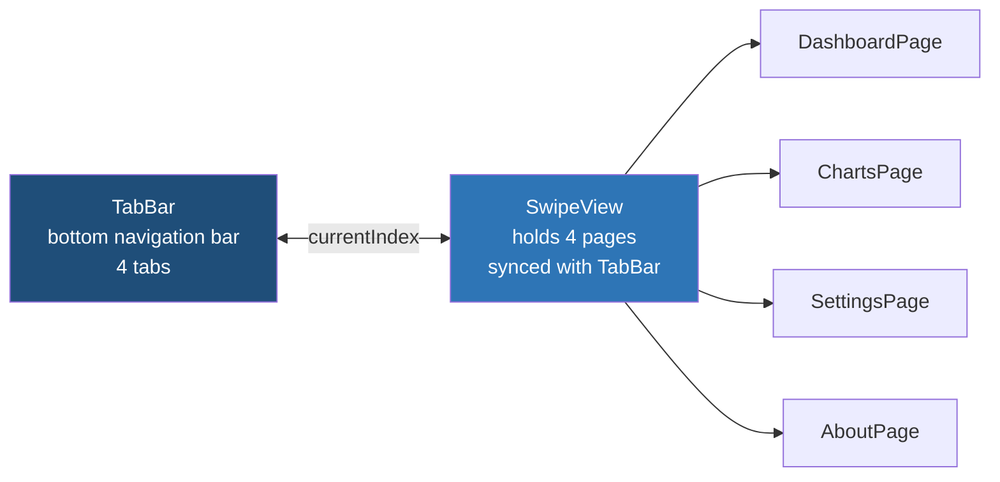
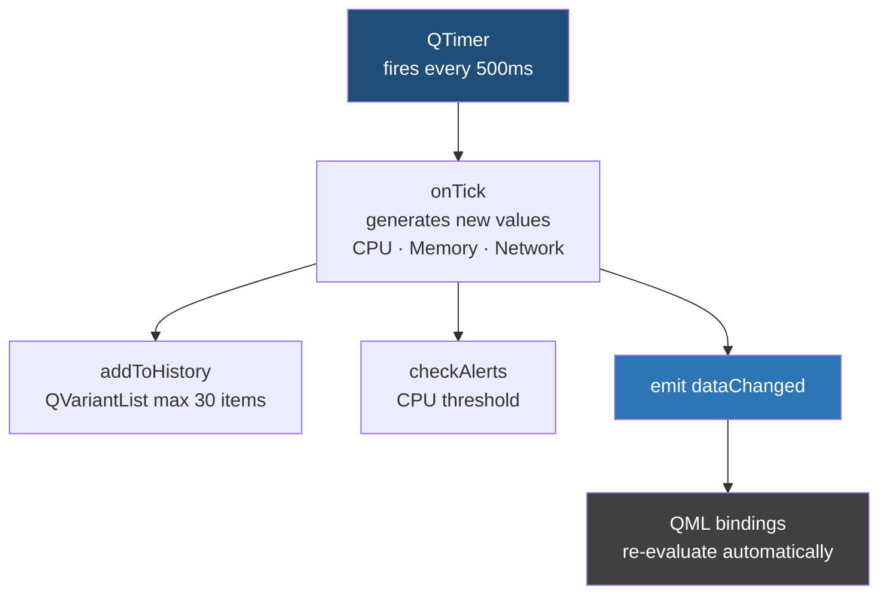
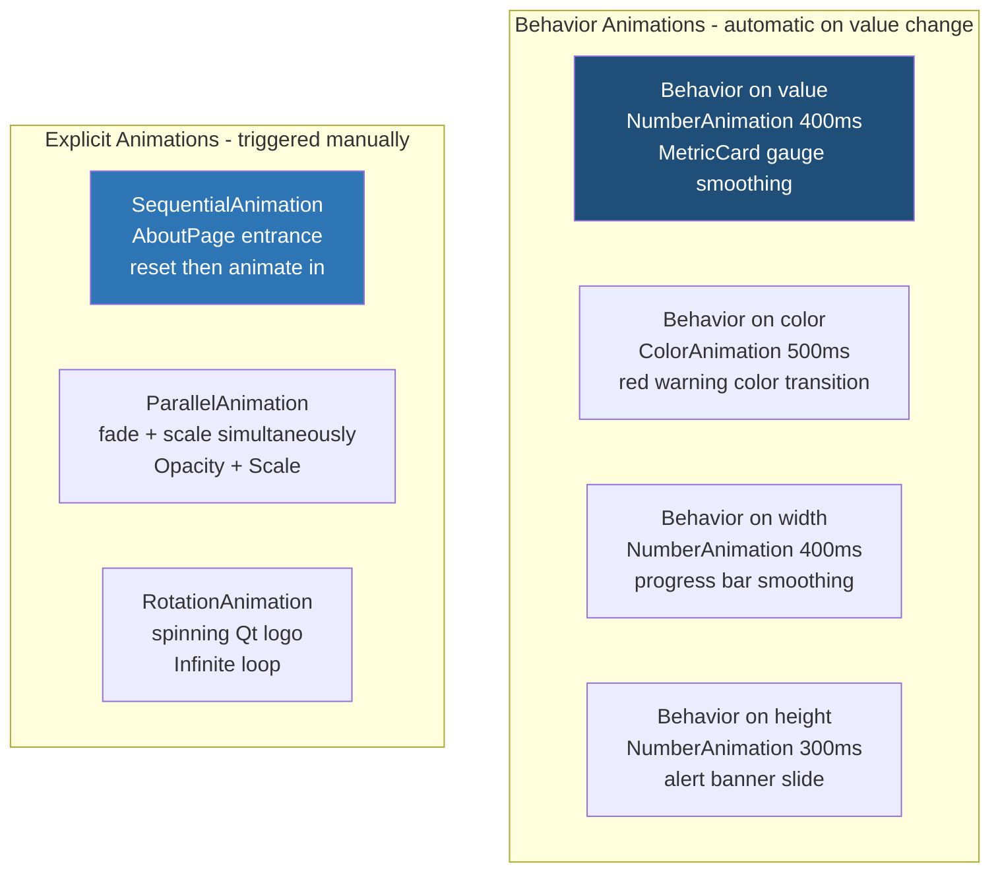

# Qt QML Dashboard — Navigation + Live Charts + Animations

A Qt6 QML project demonstrating **multi-page navigation**, **live Canvas charts**,
**smooth animations**, and a **C++ ViewModel** feeding real-time data to QML.
Four pages: Dashboard, Charts, Settings, About.

---

## 1. Prerequisites

```bash
sudo apt update
sudo apt install \
  qt6-base-dev \
  qt6-declarative-dev \
  qml6-module-qtquick \
  qml6-module-qtquick-controls \
  qml6-module-qtquick-layouts \
  qml6-module-qtquick-templates \
  qml6-module-qtquick-window \
  cmake \
  build-essential \
  qtcreator
```

| Package | Purpose |
|---|---|
| `qt6-declarative-dev` | QML engine + Qt Quick |
| `qml6-module-qtquick` | `import QtQuick` — basic QML elements |
| `qml6-module-qtquick-controls` | `Button`, `Slider`, `TabBar`, `SwipeView`, `ApplicationWindow` |
| `qml6-module-qtquick-layouts` | `ColumnLayout`, `RowLayout`, `GridLayout` |
| `qml6-module-qtquick-templates` | Required by Controls — install separately |
| `qml6-module-qtquick-window` | `ApplicationWindow` root element |

> **Important:** All six QML modules must be installed. The app builds
> without them but crashes at runtime with `Type ApplicationWindow unavailable`
> or `module not installed`.

---

## 2. Create Project in Qt Creator

1. `File → New Project → Application (Qt) → Qt Quick Application`
2. Name: `qt_qml_dashboard`
3. Location: `~/Desktop/Programming/QTprojects/`
4. Build system: **CMake**
5. Details screen: leave both checkboxes unchecked, Qt version: **Qt 6.4**
6. Kit: Qt6 Desktop → Finish

Qt Creator generates: `Main.qml`, `CMakeLists.txt`

---

## 3. Known Build Issue — Executable Name Clash

`qt_add_qml_module` creates a directory named after the URI in the build folder.
If the executable has the same name it fails with:
```
cannot open output file qt_qml_dashboard: Is a directory
```

**Fix:** executable is named `app` in `CMakeLists.txt`:
```cmake
qt_add_executable(app ...)
qt_add_qml_module(app URI qt_qml_dashboard ...)
```

---

## 4. Project File Structure

```
qt_qml_dashboard/
├── CMakeLists.txt         # qt_add_qml_module bundles all QML
├── main.cpp               # creates DataProvider, exposes to QML engine
├── dataprovider.h/.cpp    # C++ ViewModel — Q_PROPERTY + QTimer
├── Main.qml               # root window — TabBar + SwipeView + alert overlay
├── DashboardPage.qml      # page 1 — live metric cards with Canvas gauges
├── MetricCard.qml         # reusable component — gauge + progress bar
├── ChartsPage.qml         # page 2 — three live line charts
├── ChartCanvas.qml        # reusable component — Canvas line chart
├── SettingsPage.qml       # page 3 — sliders write back to C++
└── AboutPage.qml          # page 4 — animations showcase
```

**All QML files go in the project root** — no subfolders needed.

---

## 5. Architecture — MVVM with Live Data



---

## 6. Navigation — TabBar + SwipeView



```qml
SwipeView {
    id: swipeView
    currentIndex: tabBar.currentIndex   // synced to TabBar
    DashboardPage {}
    ChartsPage    {}
    SettingsPage  {}
    AboutPage     {}
}

TabBar {
    id: tabBar
    currentIndex: swipeView.currentIndex  // synced to SwipeView
    TabButton { text: "Dashboard" }
    TabButton { text: "Charts"    }
    TabButton { text: "Settings"  }
    TabButton { text: "About"     }
}
```

Changing the tab updates the SwipeView. Swiping updates the TabBar.
Both are synced via `currentIndex` binding.

---

## 7. DataProvider — C++ ViewModel



**Exposed properties:**

| Property | Type | QML Usage |
|---|---|---|
| `cpuLoad` | `double` | `dataProvider.cpuLoad` |
| `memoryMb` | `double` | `dataProvider.memoryMb` |
| `networkKbps` | `double` | `dataProvider.networkKbps` |
| `cpuHistory` | `QVariantList` | `dataProvider.cpuHistory` |
| `memoryHistory` | `QVariantList` | `dataProvider.memoryHistory` |
| `networkHistory` | `QVariantList` | `dataProvider.networkHistory` |
| `hasAlert` | `bool` | `dataProvider.hasAlert` |
| `alertMessage` | `QString` | `dataProvider.alertMessage` |
| `isRunning` | `bool` | `dataProvider.isRunning` |
| `intervalMs` | `int` (R/W) | `dataProvider.intervalMs = value` |
| `cpuThreshold` | `double` (R/W) | `dataProvider.cpuThreshold = value` |

**Invokables (callable from QML):**
```qml
dataProvider.start()
dataProvider.stop()
dataProvider.reset()
dataProvider.dismissAlert()
```

---

## 8. Animations — What's Used Where



### Behavior Animation — simplest pattern

```qml
// Any time _displayValue changes, animate smoothly
Behavior on _displayValue {
    NumberAnimation {
        duration: 400
        easing.type: Easing.OutCubic
    }
}
```

### Sequential + Parallel Animation

```qml
SequentialAnimation {
    id: entranceAnim

    // First: reset to invisible
    PropertyAction { target: content; property: "opacity"; value: 0 }

    // Then: animate opacity AND scale at the same time
    ParallelAnimation {
        NumberAnimation { target: content; property: "opacity"; to: 1.0; duration: 400 }
        NumberAnimation { target: content; property: "scale";   to: 1.0; duration: 400
                          easing.type: Easing.OutBack }
    }
}
```

### Rotation Animation — infinite loop

```qml
RotationAnimation on rotation {
    from:     0
    to:       360
    duration: 3000
    loops:    Animation.Infinite
    running:  pageVisible
}
```

---

## 9. Canvas API — Custom Drawing

QML's `Canvas` element gives you a 2D drawing API similar to HTML5 Canvas.
Used here for gauges and line charts — no Qt Charts module needed.

```qml
Canvas {
    onPaint: {
        var ctx = getContext("2d");
        ctx.clearRect(0, 0, width, height);

        // Draw arc gauge
        ctx.beginPath();
        ctx.arc(cx, cy, radius, startAngle, endAngle);
        ctx.strokeStyle = "#1565c0";
        ctx.lineWidth   = 14;
        ctx.lineCap     = "round";
        ctx.stroke();

        // Draw filled line chart
        ctx.beginPath();
        ctx.moveTo(x0, y0);
        for (var i = 1; i < points.length; i++)
            ctx.lineTo(points[i].x, points[i].y);
        ctx.strokeStyle = lineColor;
        ctx.lineWidth   = 2.5;
        ctx.stroke();
    }

    // Trigger repaint when data changes
    Connections {
        target: dataProvider
        function onDataChanged() { canvas.requestPaint(); }
    }
}
```

---

## 10. Two-Way Binding — Settings Page

QML can read AND write C++ properties:

```qml
// Slider reads from C++ and writes back on change
Slider {
    value: dataProvider.intervalMs         // READ from C++

    onValueChanged: dataProvider.intervalMs = value  // WRITE to C++
}
```

In C++ the setter triggers the timer restart:
```cpp
void DataProvider::setIntervalMs(int ms) {
    m_intervalMs = qBound(100, ms, 5000);
    m_timer->setInterval(m_intervalMs);   // applies immediately
    emit settingsChanged();
}
```

---

## 11. Reusable Components

Both `MetricCard` and `ChartCanvas` are reusable QML components.
Used like custom HTML elements:

```qml
// MetricCard used 3 times with different properties
MetricCard {
    title:       "CPU Load"
    value:       dataProvider.cpuLoad
    unit:        "%"
    maxValue:    100
    accentColor: dataProvider.cpuLoad > 80 ? "#c62828" : "#1565c0"
    icon:        "💻"
}

// ChartCanvas used 3 times
ChartCanvas {
    title:     "CPU Load (%)"
    data:      dataProvider.cpuHistory
    maxValue:  100
    lineColor: "#1565c0"
    fillColor: "#e3f2fd"
}
```

Each component is a separate `.qml` file — same concept as
a C++ class. Define once, reuse everywhere.

---

## 12. Alert System — Animated Overlay

The alert banner slides down from the top when CPU exceeds threshold:

```qml
Rectangle {
    height: dataProvider.hasAlert ? 60 : 0  // binding drives height

    // Smooth height animation
    Behavior on height {
        NumberAnimation { duration: 300; easing.type: Easing.OutCubic }
    }

    visible: height > 0  // hide when fully collapsed
}
```

When `dataProvider.hasAlert` becomes `true`:
- Height animates from 0 → 60 (slides down)
- When dismissed → height animates back to 0 (slides up)
- `visible: height > 0` prevents invisible element from capturing clicks

---

## 13. Build & Run

**Install QML modules first:**
```bash
sudo apt install \
  qml6-module-qtquick \
  qml6-module-qtquick-controls \
  qml6-module-qtquick-layouts \
  qml6-module-qtquick-templates \
  qml6-module-qtquick-window
```

**In Qt Creator:**
1. Copy all files into `qt_qml_dashboard/` project folder
2. Right-click → **Run CMake**
3. `Ctrl+B` then `Ctrl+R`

**From terminal:**
```bash
mkdir build && cd build
cmake ..
cmake --build .
./app
```

---

## 14. What This Covers

| Concept | Where |
|---|---|
| `TabBar` + `SwipeView` navigation | `Main.qml` |
| Alert overlay with slide animation | `Main.qml` |
| `Behavior { NumberAnimation }` | `MetricCard.qml` |
| `Behavior { ColorAnimation }` | `MetricCard.qml`, `SettingsPage.qml` |
| `Canvas` arc drawing — gauge | `MetricCard.qml` |
| `Canvas` line chart with fill | `ChartCanvas.qml` |
| `SequentialAnimation` | `AboutPage.qml` |
| `ParallelAnimation` | `AboutPage.qml` |
| `RotationAnimation` infinite loop | `AboutPage.qml` |
| Reusable QML components | `MetricCard`, `ChartCanvas` |
| Two-way binding — Slider → C++ | `SettingsPage.qml` |
| `QVariantList` for chart history | `DataProvider` |
| `Connections` in reusable component | `ChartCanvas.qml` |
| `Q_INVOKABLE` called from QML | `start()`, `stop()`, `reset()` |
| Alert system with threshold | `DataProvider::checkAlerts()` |
