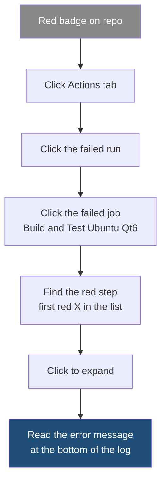
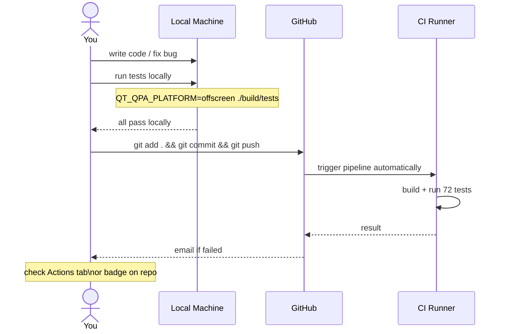

# GitHub Actions — How to Read and Use CI/CD

A practical guide to understanding the GitHub Actions interface,
reading build logs, and working with CI/CD in your daily workflow.

---

## 1. Where to Find Your CI/CD Results

Every time you push to GitHub, the pipeline runs automatically.
You can find the results in three places:

### A) The Actions Tab
```
https://github.com/Apisteftos/QTprojects/actions
```
Shows every pipeline run — green ✅ passed, red ❌ failed.

### B) The Badge in README
```markdown
[](...)
```
Live indicator directly on your repo homepage.

### C) The Commit List
Every commit on GitHub shows a small ✅ or ❌ icon next to it.
Click it to jump directly to that run's results.

---

## 2. Reading a Successful Run

When everything passes you see:

```
Build & Test (Ubuntu + Qt6)   succeeded in 52s

✅ Set up job                  1s
✅ Checkout repository         1s
✅ Install Qt6 and deps        26s
✅ Build qt_cicd_demo app      7s
✅ Build qt_cicd_demo tests    5s
✅ Run qt_cicd_demo tests      9s
✅ Build qt_test_demo          7s
✅ Run qt_test_demo tests      9s
✅ Complete job                0s
```

Each step has a time next to it. The most expensive step is
always "Install Qt6" (~26s) — GitHub downloads and installs Qt6
fresh on every run.

---

## 3. Reading a Failed Run

When something fails you see a ❌ on the failing step.
Click the step to expand it and read the logs:



### Common errors and what they mean

| Error | Cause | Fix |
|---|---|---|
| `fatal error: QTest: No such file or directory` | Missing `Qt6::Test` in CMakeLists | Add `Qt6::Test` to `target_link_libraries` |
| `Cannot find source file: main.cpp` | Wrong path in CMakeLists | Use `${CMAKE_CURRENT_SOURCE_DIR}/main.cpp` |
| `cmake: command not found` | Missing in apt install | Add `cmake` to install step |
| `Process completed with exit code 2` | Build failed | Check the lines above for compiler error |
| `FAIL: test_something` | Unit test failed | Fix the code — test caught a bug |

---

## 4. The Workflow File — How to Modify It

The workflow file is at `.github/workflows/ci.yml`.
Every time you push a change to this file, the new version runs.

### Add a new test project to CI

If you create a new project (e.g. `qt_websocket_demo`) with tests:

```yaml
      # Add these two steps to ci.yml
      - name: Build qt_websocket_demo
        run: |
          cd qt_websocket_demo
          cmake -B build -DCMAKE_BUILD_TYPE=Release
          cmake --build build --parallel

      - name: Run qt_websocket_demo tests
        run: |
          cd qt_websocket_demo/build
          QT_QPA_PLATFORM=offscreen ./qt_websocket_demo_tests -v2
```

### Install extra Qt modules

If a project needs `qt6-charts-dev` or other modules:

```yaml
      - name: Install Qt6 and build dependencies
        run: |
          sudo apt-get update
          sudo apt-get install -y \
            qt6-base-dev \
            qt6-charts-dev \        ← add here
            libqt6sql6-sqlite \
            cmake \
            build-essential
```

---

## 5. Your Daily Workflow with CI/CD



**Rule:** Always run tests locally before pushing.
If they pass locally they will pass in CI.

---

## 6. Re-running a Failed Pipeline

If CI fails for a reason unrelated to your code
(e.g. GitHub network timeout, flaky package download):

1. Go to **Actions** tab
2. Click the failed run
3. Click **"Re-run jobs"** button (top right)
4. Click **"Re-run all jobs"**

This reruns the exact same commit without a new push.

---

## 7. The Warning You See

```
Node.js 20 actions are deprecated. actions/checkout@v4
will be forced to run with Node.js 24 by default starting June 2025
```

This is just a GitHub infrastructure warning — not your code.
It means GitHub is upgrading their runner environment.
It does not affect your build. To silence it, update `ci.yml`:

```yaml
      - name: Checkout repository
        uses: actions/checkout@v4   # already the latest — warning is on GitHub's side
```

No action needed from you right now.

---

## 8. Pushing Changes — Daily Commands

```bash
# Check what changed
git status

# Stage all changes
git add .

# Or stage specific files
git add qt_cicd_demo/calculator.cpp
git add .github/workflows/ci.yml

# Commit with a clear message
git commit -m "Fix division edge case in Calculator"

# Push — this triggers CI automatically
git push origin main
```

After pushing — check:
```
https://github.com/Apisteftos/QTprojects/actions
```

---

## 9. What the Green Badge Means

When someone visits the repository and sees:

```
[![CI] passing]
```

They understand immediately:
- The code compiles on a clean Ubuntu system
- The tests pass — not just on your machine
- The project is maintained the way professional teams work
- The repo is in a releasable state at all times

This is the difference between a repository people trust
and one they skip.

---

## 10. Current CI Status

Your pipeline currently runs **72 tests** on every push:

| Project | Tests | What it tests |
|---|---|---|
| `qt_cicd_demo` | 32 | Calculator: arithmetic, evaluator, history, signals |
| `qt_test_demo` | 40 | NoteRepository: CRUD, SQL · NoteModel: cache, search |
| **Total** | **72** | **Runs in ~52 seconds** |

Every push to `main` on `https://github.com/Apisteftos/QTprojects`
triggers this pipeline automatically.
