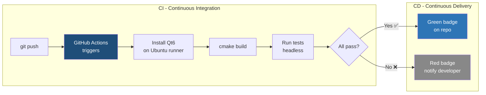
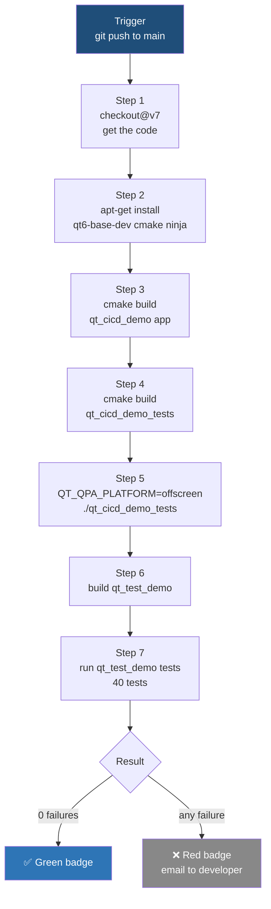

# Qt CI/CD Demo — GitHub Actions

A Qt6 C++ project demonstrating **CI/CD (Continuous Integration /
Continuous Delivery)** using **GitHub Actions**. Every push to `main`
automatically builds the app and runs 32 unit tests headlessly.

[](https://github.com/Apisteftos/QTprojects/actions/workflows/ci.yml)

---

## 1. What Is CI/CD?



**CI** — every push is automatically built and tested. Bugs caught immediately.
**CD** — if tests pass, the software is ready to ship (or deployed automatically).

---

## 2. The GitHub Actions Workflow

The workflow file lives at `.github/workflows/ci.yml`.
GitHub detects it automatically — no configuration needed.

### Trigger

```yaml
on:
  push:
    branches: [ main ]
  pull_request:
    branches: [ main ]
```

Runs on every push to `main` and every pull request targeting `main`.

### Full Pipeline



### The YAML File Explained

```yaml
name: CI

on:
  push:
    branches: [ main ]

jobs:
  build-and-test:
    runs-on: ubuntu-latest   # free GitHub-hosted Ubuntu VM

    steps:
      - uses: actions/checkout@v7   # clone the repo

      - name: Install Qt6
        run: |
          sudo apt-get update
          sudo apt-get install -y qt6-base-dev cmake build-essential

      - name: Build app
        run: |
          cd qt_cicd_demo
          cmake -B build -DCMAKE_BUILD_TYPE=Release
          cmake --build build --parallel

      - name: Build tests
        run: |
          cd qt_cicd_demo/tests
          cmake -B build
          cmake --build build --parallel

      - name: Run tests
        run: |
          cd qt_cicd_demo/tests/build
          QT_QPA_PLATFORM=offscreen ./qt_cicd_demo_tests -v2
```

`QT_QPA_PLATFORM=offscreen` — runs Qt without a display.
The GitHub runner has no screen — this env var tells Qt to render offscreen.

---

## 3. Adding the Badge to README

After the workflow runs at least once, add this to any README:

```markdown
[](https://github.com/Apisteftos/QTprojects/actions/workflows/ci.yml)
```

Shows ✅ green when all tests pass, ❌ red when any fail.

---

## 4. What Gets Tested

32 tests across Calculator operations:

| Group | Tests |
|---|---|
| Addition | positives, negatives, mixed, zero, decimals |
| Subtraction | basic, negative result, same values |
| Multiplication | basic, by zero, negatives, mixed signs |
| Division | basic, by zero, decimal result |
| Expression evaluator | all operators, invalid input, division by zero |
| History | empty, records, newest first, clear |
| Signals | resultReady, errorOccurred, historyChanged |

---

## 5. Separate App and Test Builds

The app and tests are built **separately** on purpose:

```
qt_cicd_demo/           ← needs Qt6::Widgets (has UI)
qt_cicd_demo/tests/     ← needs Qt6::Core + Qt6::Test only (no UI)
```

This means CI can run tests without a display or Widgets.
The test binary is lean and fast — no window, no event loop.

```cmake
# App CMakeLists.txt
find_package(Qt6 REQUIRED COMPONENTS Core Widgets)

# Tests CMakeLists.txt
find_package(Qt6 REQUIRED COMPONENTS Core Test)
# No Widgets — calculator.h/cpp have no widget dependency
```

---

## 6. Why CI/CD Matters

| Domain | Standard | CI/CD requirement |
|---|---|---|
| Aerospace | DO-178C | Automated test evidence required |
| Defence | AQAP-2110 | Regression testing mandatory |
| Automotive | ASPICE | Continuous integration required |
| Any modern team | Best practice | Catches bugs before code review |

Having a working CI pipeline in your public repo shows you work
the way professional teams work — not just writing code, but
ensuring it's always in a releasable state.

---

## 7. Local Build & Run

**App:**
```bash
cd qt_cicd_demo
cmake -B build && cmake --build build
./build/qt_cicd_demo
```

**Tests:**
```bash
cd qt_cicd_demo/tests
cmake -B build && cmake --build build
QT_QPA_PLATFORM=offscreen ./build/qt_cicd_demo_tests
```

**Expected output:**
```
********* Start testing of TestCalculator *********
PASS   : TestCalculator::test_add_positives()
PASS   : TestCalculator::test_divide_by_zero_fails()
...
Totals: 32 passed, 0 failed, 0 skipped
```