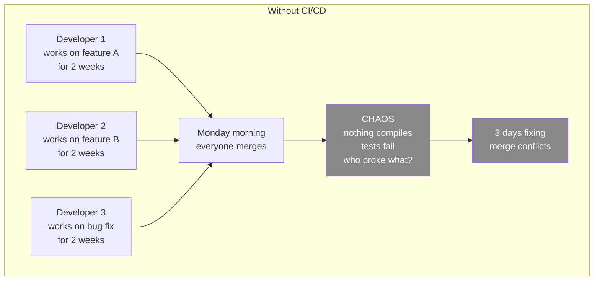
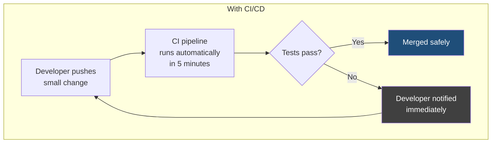
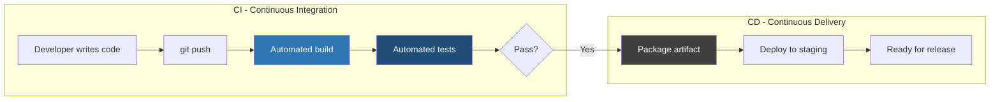
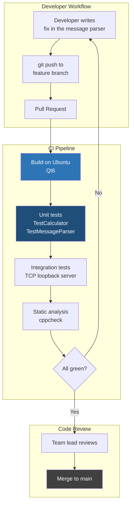
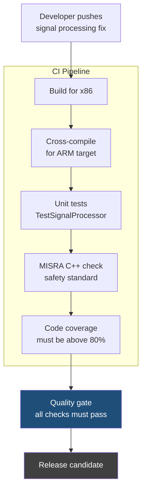
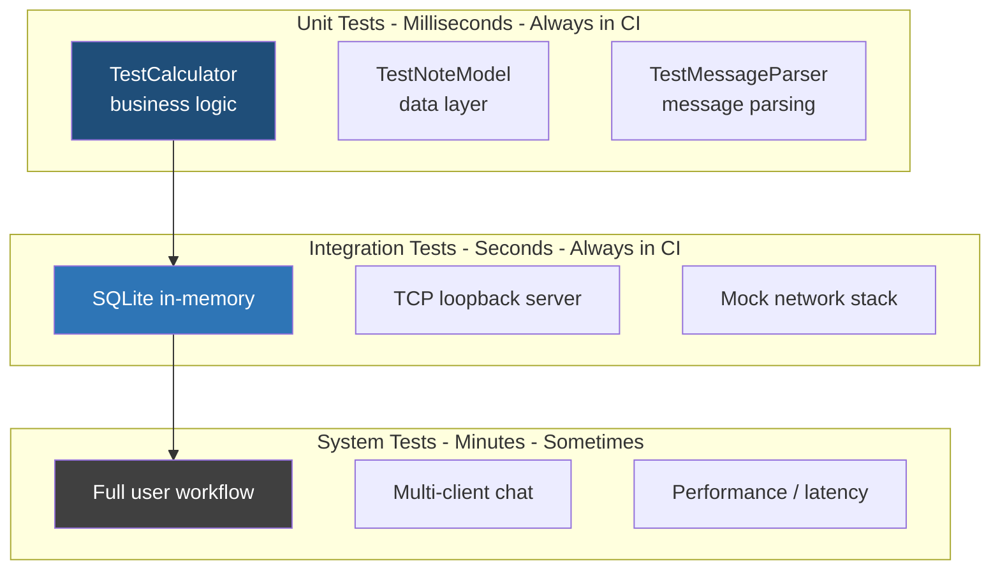
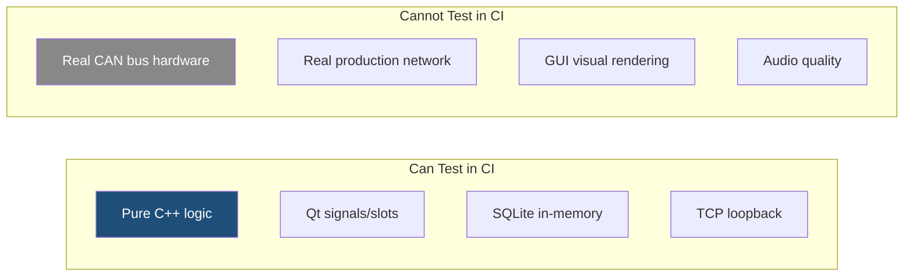
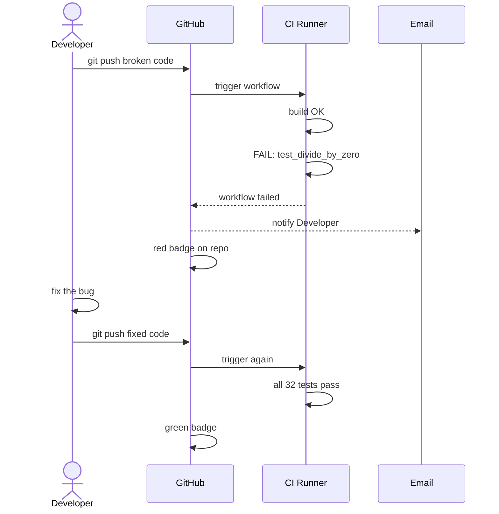

# CI/CD — Complete Guide for C++ / Qt Developers

A practical explanation of Continuous Integration and Continuous Delivery
for embedded, industrial, and safety-critical C++ projects — with examples
from Qt development.

---

## 1. What Problem Does CI/CD Solve?

Imagine a team of 5 developers working on the same Qt application.
Without CI/CD, this happens every week:





CI/CD catches problems immediately — when they are small and easy to fix.
Not two weeks later when everything is tangled together.

---

## 2. CI vs CD — What Is the Difference?



| Term | What it means | Who uses it |
|---|---|---|
| **CI** | Every push is built and tested automatically | All modern teams |
| **CD Delivery** | Tested build is packaged automatically | Most mature teams |
| **CD Deployment** | Automatically deployed to production | Web/SaaS teams |

For embedded and safety-critical projects — CI is mandatory, CD Delivery is common,
automated deployment to production is rare (human approval required).

---

## 3. Real World — How Teams Actually Use CI/CD

### A Typical Team Workflow



The CI pipeline acts as the first code reviewer — it catches obvious
problems before a human even looks at the code.

---

### Safety-Critical Embedded Software



Safety-critical projects add extra steps: MISRA C++ static analysis, code coverage
requirements, cross-compilation for target hardware.

---

## 4. What Do You Test in CI?



| Test Type | Speed | In CI? | Example |
|---|---|---|---|
| Unit tests | Milliseconds | Always | TestCalculator |
| Integration tests | Seconds | Always | SQLite in-memory |
| System tests | Minutes | Sometimes | Full workflow |
| Hardware tests | Hours | Rarely | Real CAN bus |

---

### What You CANNOT Test in CI



This is why you separate business logic from hardware-dependent code.
Pure C++ logic classes with no hardware dependency are perfect for CI.

---

## 5. The GitHub Actions Workflow — Explained

```yaml
name: CI

# Trigger on every push and pull request to main
on:
  push:
    branches: [ main ]
  pull_request:
    branches: [ main ]

jobs:
  build-and-test:
    runs-on: ubuntu-latest  # free GitHub-hosted Ubuntu VM

    steps:
      - uses: actions/checkout@v7     # get the code

      - name: Install Qt6             # same packages as your machine
        run: |
          sudo apt-get update
          sudo apt-get install -y qt6-base-dev cmake build-essential

      - name: Build app               # cmake build
        run: |
          cd qt_cicd_demo
          cmake -B build -DCMAKE_BUILD_TYPE=Release
          cmake --build build --parallel

      - name: Build tests             # separate test binary
        run: |
          cd qt_cicd_demo/tests
          cmake -B build
          cmake --build build --parallel

      - name: Run tests               # headless — no display on CI
        run: |
          cd qt_cicd_demo/tests/build
          QT_QPA_PLATFORM=offscreen ./qt_cicd_demo_tests -v2
```

`QT_QPA_PLATFORM=offscreen` — the GitHub runner has no screen.
This tells Qt to render offscreen — tests run fine without a display.

---

## 6. What Happens When a Test Fails



Main branch is never broken. The bug is caught in your branch.

---

## 7. The Build Badge

Add this to your top-level README:

```markdown
[](https://github.com/Apisteftos/QTprojects/actions/workflows/ci.yml)
```

Renders as a live green/red indicator on your repo.
Visitors see this indicator immediately when they open the repository.

---

## 8. CI/CD in Standards You Will Encounter

| Standard | Domain | CI/CD Requirement |
|---|---|---|
| **DO-178C** | Aerospace | Test coverage evidence, traceability |
| **ISO 26262** | Automotive | ASIL-rated test suites, regression |
| **AQAP-2110** | NATO defence | Build reproducibility, test reports |
| **IEC 61508** | Industrial | Verified test results per SIL level |

In all of these — automated testing is not optional.
CI/CD is the infrastructure that makes it practical at scale.

---

## 9. This Project — Tests That Run in CI

### qt_cicd_demo — 32 tests

```
TestCalculator
├── Addition (5)       — positives, negatives, decimals
├── Subtraction (3)    — basic, negative result
├── Multiplication (4) — basic, zero, signs
├── Division (3)       — basic, by zero, decimal
├── Evaluator (7)      — all operators, invalid input
├── History (4)        — empty, record, order, clear
└── Signals (4)        — resultReady, error, historyChanged
```

### qt_test_demo — 40 tests (also runs in CI)

```
TestNoteRepository (20) — CRUD, SQL, signals
TestNoteModel (20)      — cache, search, signals
```

**Total: 72 tests run automatically on every push.**

---

## 10. Run Locally Before Pushing

```bash
# Calculator tests
cd ~/Desktop/Programming/QTprojects/qt_cicd_demo/tests
cmake -B build && cmake --build build
QT_QPA_PLATFORM=offscreen ./build/qt_cicd_demo_tests

# Note tests
cd ~/Desktop/Programming/QTprojects/qt_test_demo
cmake -B build && cmake --build build
QT_QPA_PLATFORM=offscreen ./build/qt_test_demo
```

Both pass locally → push → CI passes → green badge.

---

## 11. Push the CI Pipeline to GitHub

```bash
cd ~/Desktop/Programming/QTprojects

mkdir -p .github/workflows
cp ci.yml .github/workflows/ci.yml

git add .github/
git add qt_cicd_demo/
git commit -m "Add CI/CD pipeline with GitHub Actions"
git push origin main
```

Then visit:
```
https://github.com/Apisteftos/QTprojects/actions
```

Watch the pipeline run in real time.