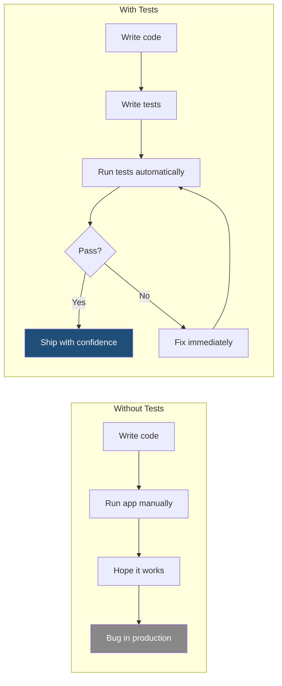
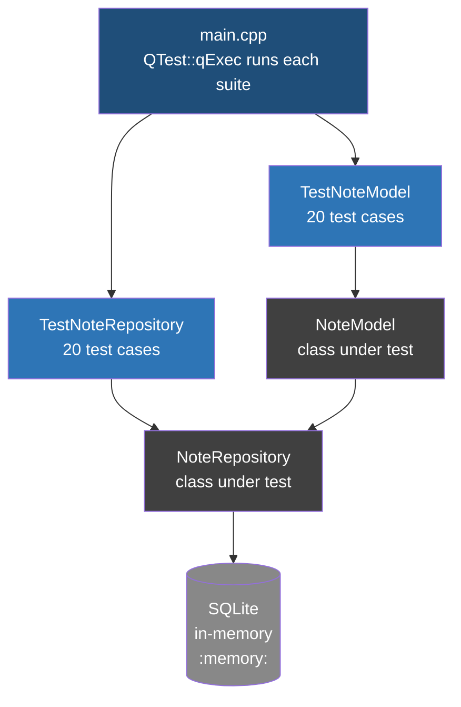
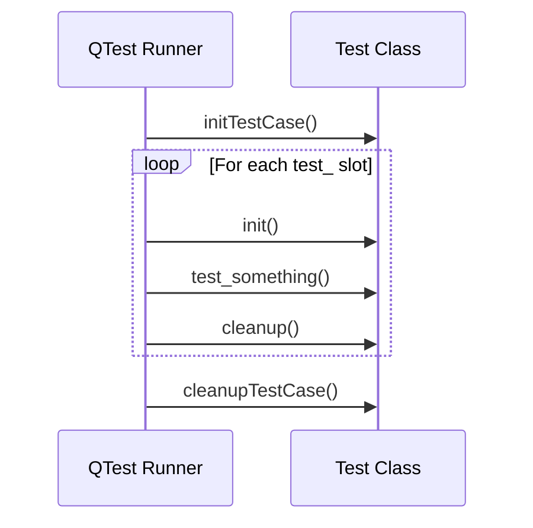

# Qt Unit Testing Demo — QTest

A Qt6 C++ project demonstrating **unit testing** with the `QTest` framework.
Tests the `NoteRepository` and `NoteModel` classes from `qt_sql_demo` using
an in-memory SQLite database — fast, isolated, no disk I/O.

---

## 1. Prerequisites

```bash
sudo apt install qt6-base-dev libqt6sql6-sqlite cmake build-essential qtcreator
```

`Qt6::Test` is included in `qt6-base-dev` — no extra package needed.

---

## 2. What Is Unit Testing?

Unit testing verifies that individual classes work correctly in isolation.
Each test is small, fast, and independent.



---

## 3. QTest — Key Concepts

### Test class structure

```cpp
class MyTest : public QObject
{
    Q_OBJECT

private slots:
    void initTestCase();    // runs ONCE before all tests
    void cleanupTestCase(); // runs ONCE after all tests
    void init();            // runs before EACH test
    void cleanup();         // runs after EACH test

    // Any slot starting with "test" is a test case
    void test_something();
    void test_somethingElse();
};
```

### Test macros

| Macro | Purpose |
|---|---|
| `QVERIFY(condition)` | Fails if condition is false |
| `QCOMPARE(actual, expected)` | Fails if values differ, shows both |
| `QVERIFY2(cond, message)` | Like QVERIFY with custom message |
| `QFAIL("message")` | Always fails — marks work in progress |
| `QTest::qWait(ms)` | Wait N milliseconds (for timing tests) |

### QSignalSpy — test signals

```cpp
QSignalSpy spy(object, &MyClass::mySignal);
object->doSomething();

QCOMPARE(spy.count(), 1);              // signal fired once
QCOMPARE(spy.first().first().toInt(), 42); // first arg = 42
```

---

## 4. Test Architecture



---

## 5. In-Memory Database — Key Concept

Every test gets a **fresh isolated database** via SQLite's `:memory:` path:

```cpp
void init() {
    // ":memory:" = SQLite in-memory database
    // Created fresh for every single test
    // Destroyed when the connection closes
    m_repo = new NoteRepository(":memory:");
    m_repo->open();
    m_model = new NoteModel(m_repo);
}

void cleanup() {
    delete m_model;
    delete m_repo;
    // Remove the named Qt SQL connection
    QSqlDatabase::removeDatabase("notes_connection");
}
```

**Why this matters:**
- Tests never interfere with each other
- No leftover data from previous tests
- No dependency on disk files
- Runs in milliseconds (no I/O)

---

## 6. Test Lifecycle



---

## 7. What's Tested

### TestNoteRepository (20 tests)

| Test | Verifies |
|---|---|
| `test_openDatabase` | DB opens successfully |
| `test_initiallyEmpty` | Fresh DB has 0 notes |
| `test_createNote_basic` | Insert works, count increases |
| `test_createNote_emptyTitleFails` | Validation rejects empty title |
| `test_createNote_whitespaceOnlyTitleFails` | Trims and rejects whitespace |
| `test_createNote_emptyBodyAllowed` | Body is optional |
| `test_createMultipleNotes` | Multiple inserts work |
| `test_getAllNotes_returnsCorrectData` | SELECT returns correct data |
| `test_getNoteById_existing` | Find by id works |
| `test_getNoteById_nonExistent` | Returns empty Note for bad id |
| `test_updateNote_changesContent` | UPDATE changes title and body |
| `test_updateNote_updatedAtChanges` | Timestamp updated on edit |
| `test_deleteNote_removesFromDB` | DELETE removes the row |
| `test_deleteNote_nonExistentIsOk` | Delete bad id doesn't crash |
| `test_noteCount_accurate` | COUNT(*) tracks correctly |
| `test_signals_noteCreatedEmitted` | noteCreated signal fires |
| `test_signals_noteDeletedEmitted` | noteDeleted fires with correct id |
| `test_signals_errorEmittedOnEmptyTitle` | errorOccurred fires on invalid input |

### TestNoteModel (20 tests)

| Test | Verifies |
|---|---|
| `test_initiallyEmpty` | Model starts empty |
| `test_load_populatesFromRepo` | load() fetches from DB |
| `test_addNote_increasesCount` | count() increases |
| `test_addNote_emitsNoteAdded` | noteAdded signal fires |
| `test_addNote_emptyTitleEmitsError` | Validation error propagated |
| `test_noteAt_returnsCorrectNote` | Correct item returned by index |
| `test_noteAt_invalidIndexReturnsEmpty` | No crash on bad index |
| `test_deleteNote_decreasesCount` | count() decreases |
| `test_deleteNote_emitsNoteDeleted` | Signal fires with correct id |
| `test_updateNote_changesContent` | In-memory cache updated |
| `test_updateNote_emitsNoteUpdated` | noteUpdated signal fires |
| `test_search_findsMatchingTitle` | Title search works |
| `test_search_findsMatchingBody` | Body search works |
| `test_search_caseInsensitive` | Case doesn't matter |
| `test_search_noMatchReturnsEmpty` | Empty result on no match |
| `test_clearSearch_restoresAll` | Full list restored after search |
| `test_indexById_found` | Correct index returned |
| `test_indexById_notFound` | Returns -1 for missing id |

---

## 8. Running the Tests

**In Qt Creator:**
- `Ctrl+R` runs the test executable
- Output appears in Application Output panel
- Green = pass, Red = fail

**From terminal:**
```bash
cd build/Desktop-Debug
./qt_test_demo
```

**Headless (no display required):**
```bash
QT_QPA_PLATFORM=offscreen ./qt_test_demo
```

**With CTest (CI integration):**
```bash
cd build
ctest --output-on-failure
```

**Expected output:**
```
********* Start testing of TestNoteRepository *********
PASS   : TestNoteRepository::test_openDatabase()
PASS   : TestNoteRepository::test_createNote_basic()
...
Totals: 20 passed, 0 failed, 0 skipped
********* Start testing of TestNoteModel *********
...
Totals: 20 passed, 0 failed, 0 skipped
```

---

## 9. CMakeLists — Test Module

```cmake
find_package(Qt6 REQUIRED COMPONENTS Core Widgets Sql Test)

target_link_libraries(qt_test_demo PRIVATE
    Qt6::Core
    Qt6::Widgets
    Qt6::Sql
    Qt6::Test    # QTest, QSignalSpy, QVERIFY, QCOMPARE
)

# Register with CTest for CI
include(CTest)
add_test(NAME qt_test_demo COMMAND qt_test_demo)
```

---

## 10. Why Testing Matters in Industry

Companies in aerospace, defence, and automotive operate under strict
quality standards:

| Standard | Domain | Requires |
|---|---|---|
| DO-178C | Aerospace software | Unit tests with coverage |
| ISO 26262 | Automotive safety | Test evidence per ASIL level |
| IEC 61508 | Industrial safety | Verified and validated software |

Unit tests show that a project is built like production-quality
software — not just demo code.

---

## 11. Create the Project in Qt Creator

**Project type: Test Project → Qt Test Project**

```
File → New Project...
├── Left panel:  Test Project
├── Right panel: Qt Test Project
└── Next
    ├── Name:         qt_test_demo
    ├── Location:     ~/Desktop/Programming/QTprojects/
    ├── Build system: CMake
    └── Next
        ├── Test framework: QTest
        ├── Test case name: leave default
        ├── Kit: Qt6 Desktop
        └── Finish
```

Qt Creator generates a minimal test project with:
- `main.cpp` — uses `QTEST_MAIN` macro
- `tst_qt_test_demo.h` or `.cpp` — a single empty test class
- `CMakeLists.txt` — already links `Qt6::Test`

---

## 12. Replace Generated Files

After Qt Creator creates the project, replace everything with our files:

| File | Action | Source |
|---|---|---|
| `main.cpp` | Replace | provided |
| `CMakeLists.txt` | Replace | provided |
| `tst_qt_test_demo.cpp` | Delete | not needed |
| `noterepository.h` | New | copy from `qt_sql_demo/` |
| `noterepository.cpp` | New | copy from `qt_sql_demo/` |
| `notemodel.h` | New | copy from `qt_sql_demo/` |
| `notemodel.cpp` | New | copy from `qt_sql_demo/` |
| `test_noterepository.h` | New | provided |
| `test_notemodel.h` | New | provided |

Then in Qt Creator:
1. Right-click project → **Run CMake**
2. `Ctrl+B` to build
3. `Ctrl+R` to run

---

## 13. Expected Output

No window will appear — test results print directly to the
**Application Output** panel in Qt Creator:

```
********* Start testing of TestNoteRepository *********
PASS   : TestNoteRepository::test_openDatabase()
PASS   : TestNoteRepository::test_createNote_basic()
PASS   : TestNoteRepository::test_createNote_emptyTitleFails()
...
Totals: 20 passed, 0 failed, 0 skipped
********* Finished testing of TestNoteRepository *********

********* Start testing of TestNoteModel *********
PASS   : TestNoteModel::test_initiallyEmpty()
PASS   : TestNoteModel::test_addNote_increasesCount()
...
Totals: 20 passed, 0 failed, 0 skipped
********* Finished testing of TestNoteModel *********
```

Qt Creator also has a dedicated **Tests** panel in the left sidebar
that shows results with green/red indicators per test case.

---

## 14. Details Screen — Project and Test Information

After selecting **Test Project → Qt Test Project** and setting the name/location,
Qt Creator shows this screen:

| Field | Value |
|---|---|
| **Test case name** | `qt_test_demo` |
| **Requires QApplication** | ✅ checked — we use `QApplication` in `main.cpp` |
| **GUI Application** | ☐ unchecked |
| **Generate initialization and cleanup code** | ✅ checked — generates `initTestCase` and `cleanupTestCase` |
| **Build system** | CMake |

### Why these options matter

**Requires QApplication** — check this because our classes (`NoteModel`,
`NoteRepository`) use `QSqlDatabase` and Qt signals which need an event loop.
Without it the test executable crashes on startup.

**Generate initialization and cleanup code** — check this so Qt Creator
generates the `initTestCase()` / `cleanupTestCase()` / `init()` / `cleanup()`
lifecycle stubs automatically. These are the hooks we use to create and
destroy a fresh in-memory database for every test.

**GUI Application** — leave unchecked. Our tests have no window — results
print to the Application Output panel. Checking this would create an
unnecessary `QApplication` with a display requirement.
